# Diagrams

One picture per topic, showing what Java actually does in memory. Start with **00** (the map), then read each
diagram before or while you work on its exercises. Click an image to open it in full size.

Stuck on an exercise? Every topic has a **step-by-step guide** (last column below): pictures, steps,
hints and common mistakes for every method, without giving away the code.

Every diagram uses the same colours:
**blue** = Stack (method frames, local variables), **violet** = Heap (objects, arrays) and the arrows into it,
**gray** = Java code, **orange** = a question / condition or a copied value, **green** = true / valid,
**red** = false / error, **teal** = a return value, **yellow hand-drawn notes** = explanations.

| # | Diagram | Practise with | Step-by-step guide |
|---|---------|---------------|--------------------|
| 00 | [Java learning map](#00--java-learning-map) | | |
| 01 | [Variables & primitive types](#01--variables-primitive-types--memory) | recap `BasicExpressions` | [topic 01 guide](topic-01-guide.md) |
| 02 | [Conditions & short-circuit](#02--conditions--short-circuit) | recap `Conditionals` | [topic 02 guide](topic-02-guide.md) |
| 03 | [Loops](#03--loops) | recap `LoopPractice` | [topic 03 guide](topic-03-guide.md) |
| 04 | [Methods & the call stack](#04--methods--the-call-stack) | recap `MethodDecomposition` | [topic 04 guide](topic-04-guide.md) |
| 05 | [Arrays](#05--arrays) | recap `ArrayBasics`, `ArrayChallenges`; `ArrayStats` | [topic 05 guide](topic-05-guide.md) |
| 06 | [2D arrays](#06--2d-arrays) | recap `GridBasics`; `MatrixOps` | [topic 06 guide](topic-06-guide.md) |
| 07 | [Classes, objects & encapsulation](#07--classes-objects--encapsulation) | recap `Rectangle`; `BankAccount` | [topic 07 guide](topic-07-guide.md) |
| 08 | [Pass-by-value & references](#08--pass-by-value--references) | recap `Point`, `PointTools`; `Player`, `TeamRoster` | [topic 08 guide](topic-08-guide.md) |
| 09 | [Inheritance & dynamic dispatch](#09--inheritance--dynamic-dispatch) | recap shapes; smart home | [topic 09 guide](topic-09-guide.md) |
| 10 | [Recursion & linked structures](#10--recursion--linked-structures) | recap `RecursionBasics`; `RecursiveUtils` | [topic 10 guide](topic-10-guide.md) |

(Before the `;` = recap exercise, after it = main exercise.)

**How to study with them:** cover the right half of a diagram and predict the result before you read the notes.
Trace with a finger, one arrow at a time. Then answer the questions under the diagram, and only then open the answers.

---

## 00 · Java learning map
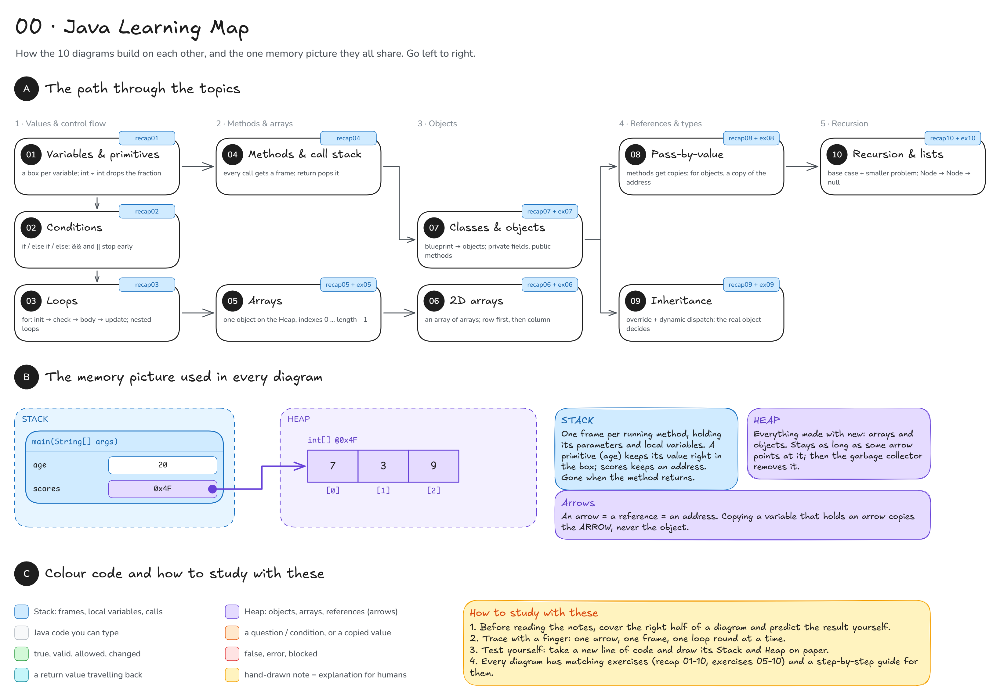

## 01 · Variables, primitive types & memory
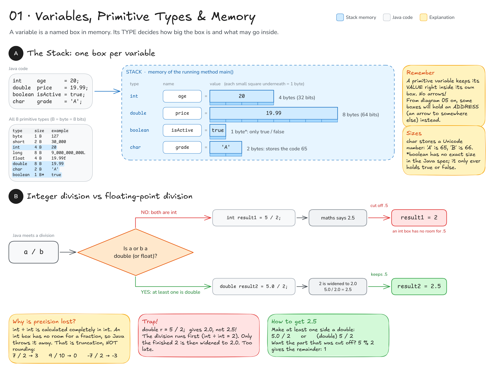

**Check yourself**
1. What does `System.out.println(7 / 2);` print? And `7 / 2.0`?
2. `double d = 1 / 4;` What is in `d`?
3. What is `7 % 3`?

Answers

1. `3` (int ÷ int cuts the fraction off), then `3.5`.
2. `0.0`: `1 / 4` is computed as int first (`0`), only then widened.
3. `1`, the remainder that integer division threw away.

## 02 · Conditions & short-circuit
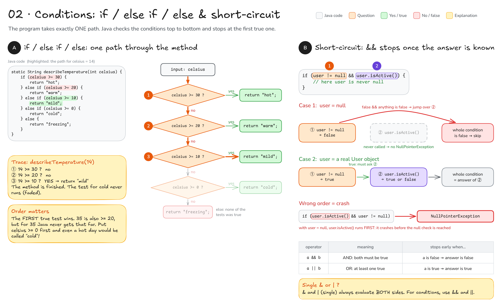

**Check yourself**
1. What do `describeTemperature(20)` and `describeTemperature(-5)` return?
2. With `user = null`, does `if (user != null || user.isActive())` crash?

Answers

1. `"warm"` (20 >= 20 is true, so the boundary belongs to "warm"), and `"freezing"` (no test is true, so the `else` runs).
2. Yes. `false || …` does NOT know the answer yet, so `user.isActive()` runs on `null` → NullPointerException.

## 03 · Loops
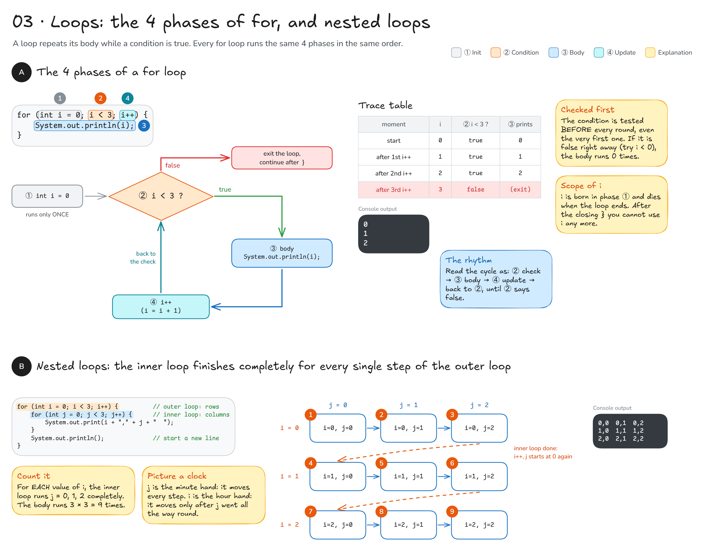

**Check yourself**
1. How many times does the body of `for (int i = 5; i < 3; i++)` run?
2. What does `for (int i = 0; i <= 3; i++) System.out.print(i);` print?
3. An outer loop of 4 rounds with an inner loop of 5 rounds: how many times does the inner body run?

Answers

1. 0 times: the condition is checked first and is false right away.
2. `0123`: `<=` includes 3.
3. 4 × 5 = 20.

## 04 · Methods & the call stack
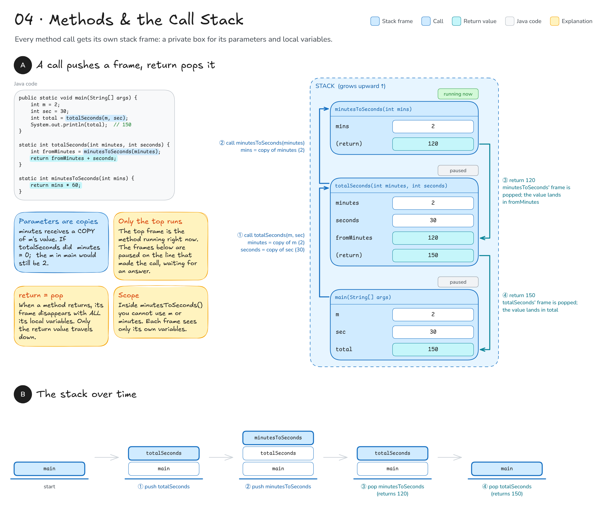

**Check yourself**
1. If `totalSeconds` did `minutes = 0;`, what would `m` in `main` be?
2. While `minutesToSeconds` runs, how many frames are on the stack?

Answers

1. Still `2`: `minutes` is a copy.
2. Three: `main`, `totalSeconds`, `minutesToSeconds`.

## 05 · Arrays
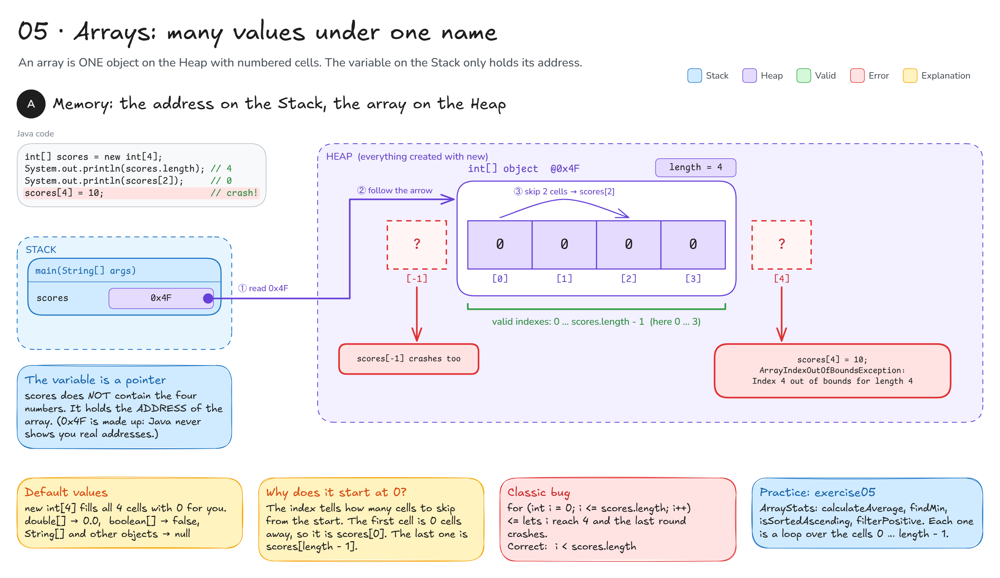

**Check yourself**
1. `int[] a = new int[5];` What is `a.length` and the last valid index?
2. `boolean[] b = new boolean[2];` What is `b[1]`?
3. `int[] x = {1, 2, 3}; int[] y = x; y[0] = 99;` What is `x[0]`?

Answers

1. `5`, and index `4`.
2. `false` (the default value).
3. `99`: `y = x` copies the arrow, so both variables point at the SAME array (see diagram 08).

## 06 · 2D arrays
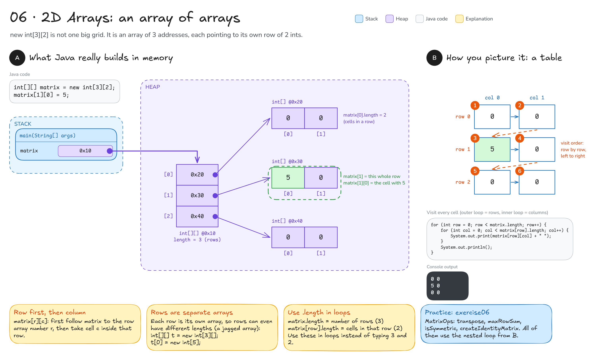

**Check yourself**
1. `int[][] m = new int[4][7];` What are `m.length` and `m[0].length`?
2. With the nested loop from section B, is `m[0][1]` or `m[1][0]` visited first?

Answers

1. `4` rows, `7` cells per row.
2. `m[0][1]`: the whole row 0 is finished before row 1 starts.

## 07 · Classes, objects & encapsulation
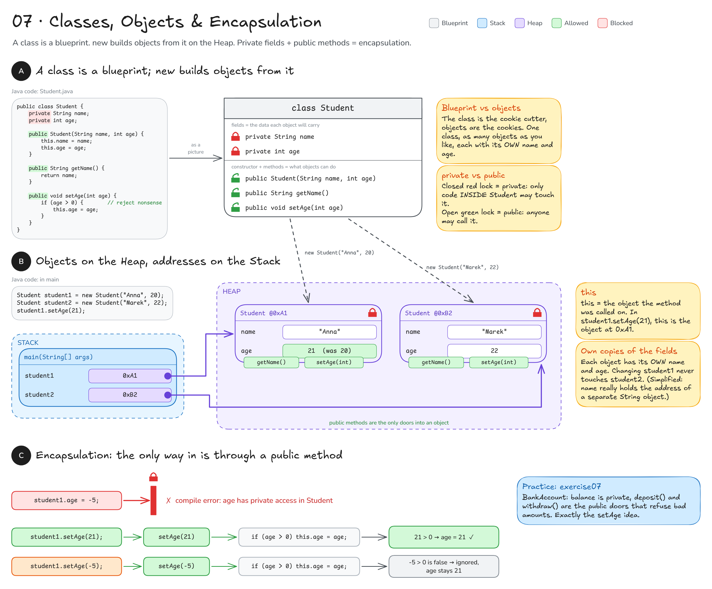

**Check yourself**
1. Why does `student1.age = 30;` not compile in `main`?
2. After `student1.setAge(-3);` what is the age?
3. `Student a = new Student("X", 1); Student b = a;` How many Student objects exist?

Answers

1. `age` is `private`: only code inside `Student` may touch it.
2. Unchanged: the check `if (age > 0)` refuses it.
3. One. `b = a` copies the arrow, not the object.

## 08 · Pass-by-value & references
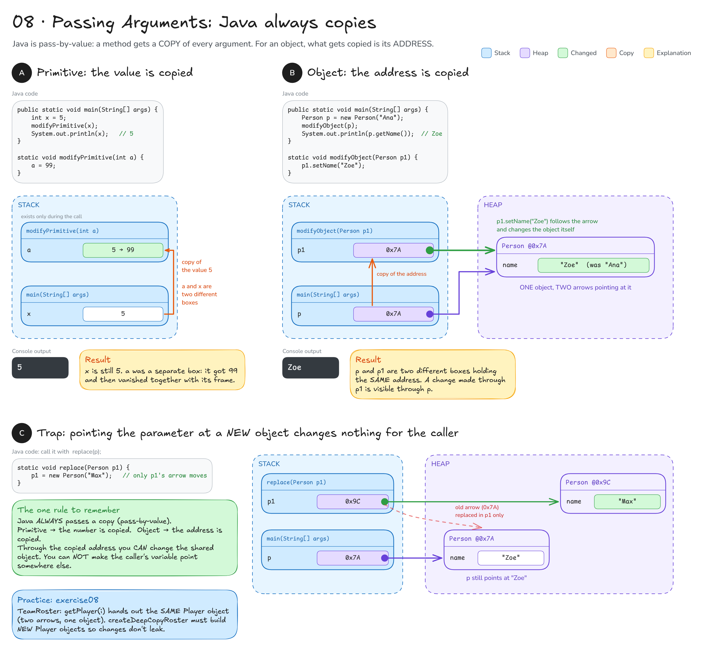

**Check yourself**
1. `static void inc(int n) { n++; }` After `int k = 1; inc(k);` what is `k`?
2. `static void rename(Person q) { q.setName("Bob"); }` After `rename(p);` what is `p.getName()`?
3. Does `static void swap(Person a, Person b) { Person t = a; a = b; b = t; }` swap the caller's variables?

Answers

1. `1`: `n` was a copy.
2. `"Bob"`: `q` holds a copy of the address, so it changes the same object.
3. No. It only swaps the method's own copies of the arrows.

## 09 · Inheritance & dynamic dispatch
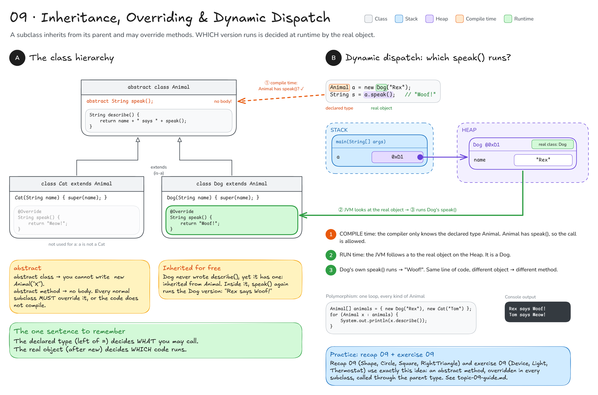

**Check yourself**
1. `Animal a = new Cat("Tom");` What does `a.speak()` return?
2. Only `Dog` has a `fetch()` method. Does `Animal a = new Dog("Rex"); a.fetch();` compile?
3. Can you write `new Animal("X")`?

Answers

1. `"Meow!"`: the real object is a Cat, so its version runs.
2. No. The declared type `Animal` decides what you may call, and Animal has no `fetch()`.
3. No, `Animal` is abstract.

## 10 · Recursion & linked structures
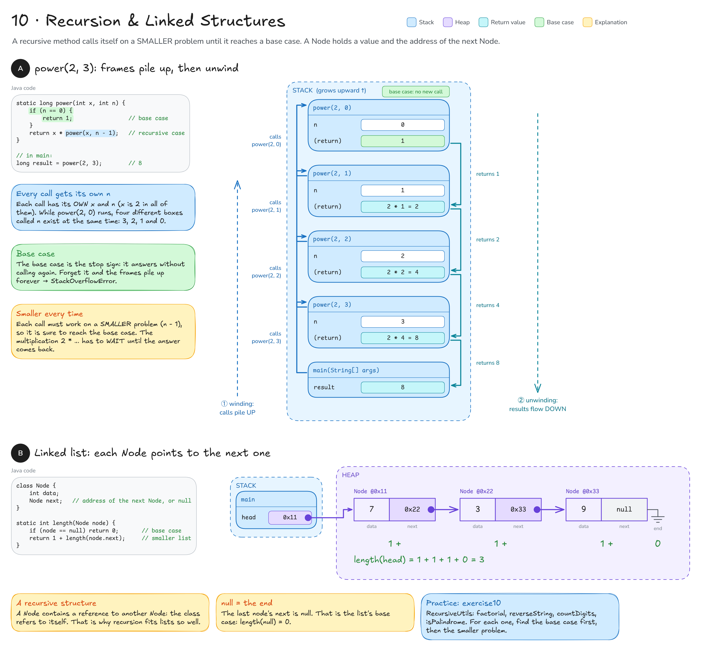

**Check yourself**
1. What does `countdown(1)` return? How many `countdown` frames are on the stack at the deepest point of `countdown(4)`?
2. What happens if you delete the base case?
3. A list has a single node with `data = 5`. What does `printReverse` print?

Answers

1. `"1 Go!"`, and 5 frames: `countdown(4)` down to `countdown(0)`.
2. The calls never stop (n goes 0, -1, -2, …) → `StackOverflowError`.
3. `5 `: first `printReverse(null)` prints nothing, then the node prints itself.

