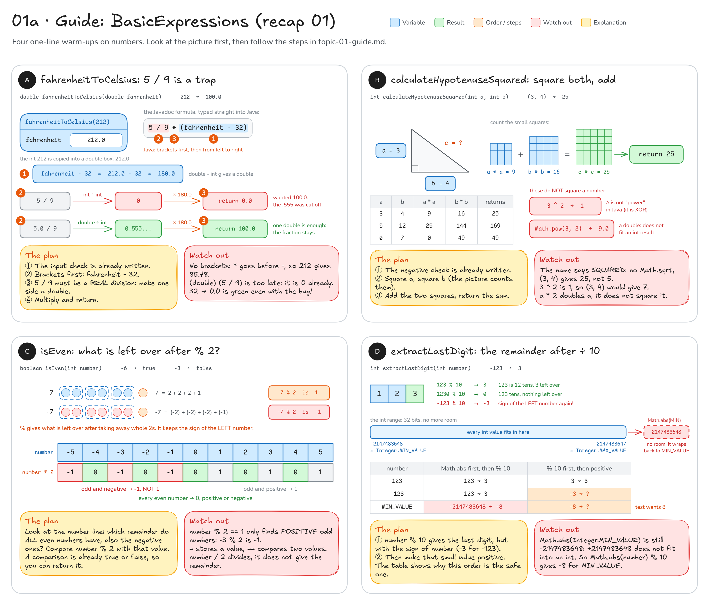

# Topic 1 · Variables, primitive types & operators: step-by-step guide

This guide walks you through **recap 01 (`BasicExpressions`)**. Topic 1 has no main exercise, only this warm-up.
It gives you pictures, steps and hints, **not finished code**: you still write every method yourself.

**How to use it:** do one method at a time. Look at its picture, follow the steps, write the code,
then run that method's tests. Only when they are green, move on.

## Before you start: five facts

1. A variable is a named box in memory, and its **type** decides what fits in it: an `int` holds whole numbers
   (`212`, `-3`), a `double` holds numbers with a fraction (`212.0`, `0.555...`).
   (See [diagram 01](README.md#01--variables-primitive-types--memory) for the picture.)
2. `int / int` is **whole-number division**: Java cuts the fraction off. `7 / 2` is `3`, `5 / 9` is `0`.
   As soon as **one** side is a `double`, you get the real result: `7.0 / 2` is `3.5`.
3. Java works out an expression in this order: **brackets** first, then `*` `/` `%`, then `+` `-`.
   Operators of the same level go from **left to right**.
4. `%` is the **remainder**: what is left over after a whole-number division. `7 % 2` is `1`, `123 % 10` is `3`.
   The remainder keeps the sign of the **left** number: `-7 % 2` is `-1`, `-123 % 10` is `-3`.
5. An `int` has limits: from `Integer.MIN_VALUE` (`-2147483648`) to `Integer.MAX_VALUE` (`2147483647`).
   A result outside that range does not fit and **wraps around** to the other end.

```java
int a = 7;
int b = 2;
System.out.println(a / b);                 // 3     whole-number division cuts off the .5
System.out.println(7.0 / b);               // 3.5   one double is enough
System.out.println(a % b);                 // 1     7 = 2 + 2 + 2 + 1
System.out.println(-a % b);                // -1    the remainder keeps the sign of -7
System.out.println(Integer.MAX_VALUE + 1); // -2147483648   it wrapped around
```

---

## Recap 01: `BasicExpressions`

You write: `src/main/java/sk/upjs/paz1a/tutoring/recap/exercise01/BasicExpressions.java`. Tests: `BasicExpressionsTest`.
The input checks of `fahrenheitToCelsius` and `calculateHypotenuseSquared` are already written for you (the `if` with
`throw`), so you only write the calculation below them. Every method needs just a line or two.

Some tests are green before you write anything, because the placeholder (`return 0.0;`, `return 0;` or `return false;`) happens to give
the right answer for them. That proves nothing: a method is done when **all** of its tests are green.



### A · `fahrenheitToCelsius`: watch out for `5 / 9`

**Goal:** the Javadoc formula `C = 5/9 * (F - 32)`. `212` → `100.0`, `32` → `0.0`, `-40` → `-40.0`, `98.6` → `37.0`.

1. Compute `fahrenheit - 32` first. For `212` this piece is `212.0 - 32 = 180.0` (`fahrenheit` is a `double`,
   so the result is a `double` too). If you write everything in one line, this part needs brackets: without them
   Java would multiply first and subtract 32 at the very end.
2. Compute the factor 5/9. Careful: `5 / 9` is `int / int`, so it is `0`, and everything multiplied by 0 is 0.
   Make it a **real** division: at least one of the two numbers must be a `double` (fact 2).
   The factor must come out as `0.555...`.
3. Multiply the two pieces and return the result. `0.555... * 180.0` is `100.0`.

Fill in the blanks (below the input check that is already there):

```java
double difference = fahrenheit - ___;   // 212.0 - 32 = 180.0
double factor = ___;                    // must be 0.555..., NOT 0
return ___;
```

**Check:** run `BasicExpressionsTest`: `freezingPointOfWater`, `boilingPointOfWater`, `minusFortyIsTheSameInBothScales`,
`humanBodyTemperature`, `zeroFahrenheitIsBelowZeroCelsius`, `absoluteZeroIsStillAllowed` and
`temperatureBelowAbsoluteZeroIsRejected` should be green.

**Common mistakes**
- Typing the formula exactly as it looks, `5 / 9 * (...)`: it always returns `0.0`. `freezingPointOfWater` is green
  anyway (the right answer for 32 is `0.0`!), but `boilingPointOfWater` asks
  "Is 5 / 9 computed as an integer division (which gives 0)?".
- `(double) (5 / 9)`, or storing `5 / 9` in a `double` variable: too late. The brackets are computed first,
  as `int / int = 0`, and only that finished `0` becomes `0.0`.
- Forgetting the brackets around `fahrenheit - 32`: `*` comes before `-`, so `212` gives `85.78` instead of `100.0`.

### B · `calculateHypotenuseSquared`: square both legs, add them

**Goal:** the Javadoc formula `a*a + b*b`. `(3, 4)` → `25`, `(5, 12)` → `169`, `(0, 7)` → `49`, `(0, 0)` → `0`.

1. Square `a`: multiply it by itself. For `3` that is `9`, the 3 × 3 small squares in the picture.
2. Square `b` the same way: `4` → `16`.
3. Add the two squares and return the sum: `9 + 16 = 25`.
   `*` comes before `+`, so you do not even need brackets.

**Check:** `classicThreeFourFiveTriangle`, `anotherRightTriangle`, `oneLegOfLengthZero`, `bothLegsZero`,
`negativeLengthsAreRejected`.

**Common mistakes**
- `a ^ 2`: Java has **no** "to the power" operator. `^` is something else (XOR), and `3 ^ 2` is `1`,
  so `(3, 4)` gives `7`.
- `Math.pow(a, 2)`: it returns a `double` (`9.0`), and a `double` does not fit into the `int` the method returns,
  so the code does not compile ("possible lossy conversion from double to int"). Multiplying is simpler.
- `Math.sqrt(...)`: the method returns the **square** of the hypotenuse, `25` for `(3, 4)`, not the length `5`.
- `a * 2`: that doubles `a` (`6`) instead of squaring it (`9`).

### C · `isEven`: what is left over after `% 2`?

**Goal:** `4` → `true`, `7` → `false`, `0` → `true`, `-6` → `true`, `-3` → `false`.
Also `Integer.MAX_VALUE` → `false` and `Integer.MIN_VALUE` → `true`.

1. Look at the number line in the picture: the row `number % 2` shows the remainder for -5 … 5.
2. Find the remainder that **every** even number has, the negative ones too. (Odd numbers do not agree with each
   other: `7 % 2` is `1`, but `-7 % 2` is `-1`.)
3. Compare `number % 2` with that value using `==`.
4. A comparison like `x == y` already **is** a `boolean` (`true` or `false`), so you can return it directly.
   An `if` that returns `true` in one branch and `false` in the other also works, it is just longer.

**Check:** `positiveEvenNumber`, `positiveOddNumber`, `zeroIsEven`, `negativeEvenNumber`, `negativeOddNumber`,
`extremeValues`.

**Common mistakes**
- Testing for "odd" with `number % 2 == 1` and flipping the answer: `-3 % 2` is `-1`, not `1`, so `-3` looks even.
  `negativeOddNumber` says "In Java -3 % 2 is -1, not 1".
- `number % 2 = 0`: one `=` **stores** a value and does not compile here; `==` **compares** two values.
- `number / 2`: that divides. You want the remainder, which is `%`.

### D · `extractLastDigit`: the remainder after dividing by 10

**Goal:** `123` → `3`, `7` → `7`, `0` → `0`, `1230` → `0`, `-123` → `3`, `Integer.MIN_VALUE` → `8`.

1. The last digit is the remainder after dividing by 10: `123` is 12 tens and **3** left over, so `123 % 10` is `3`.
2. For a negative number the remainder is negative too: `-123 % 10` is `-3` (fact 4). The test wants `3`.
3. So the result has to be made positive. The question is **when**: before or after the `% 10`?
   The table in the picture tries both orders on `Integer.MIN_VALUE` (`-2147483648`). Fill in its `?` cells.
4. Why does the order matter? `Math.abs(-2147483648)` would be `+2147483648`, and that is one more than the biggest
   `int` (fact 5). It does not fit, wraps around, and you get `-2147483648` back, still negative.
   A remainder after `% 10` is always between `-9` and `9`, and those are safe to make positive.

**Check:** `lastDigitOfPositiveNumber`, `singleDigitNumber`, `zeroEndsWithZero`, `multipleOfTenEndsWithZero`,
`negativeNumberGivesPositiveDigit`, `smallestIntEndsWithEight`.

**Common mistakes**
- Only `number % 10`: `-123` gives `-3`. `negativeNumberGivesPositiveDigit` says "In Java -123 % 10 is -3".
- Making `number` positive **first** (with `Math.abs(number)` or with `-number`): every test passes except
  `smallestIntEndsWithEight`, which gets `-8` instead of `8`.
- `number / 10`: that gives `12`, the number **without** its last digit.

---

**Still stuck?** Print the pieces. Put lines like `System.out.println(5 / 9);` or `System.out.println(-123 % 10);`
into a small `main` method and compare the output with the numbers in the picture. In this recap, almost every bug is
one piece that is an `int` where you expected a `double`, or a remainder that carries a minus sign.
