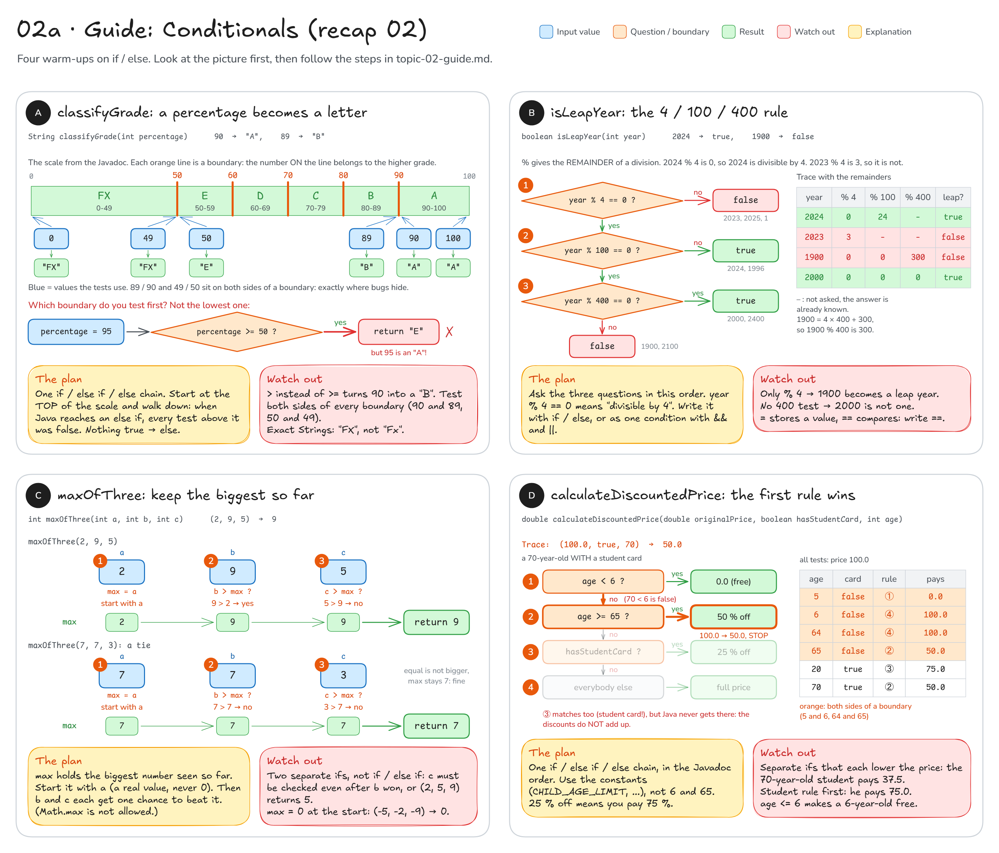

# Topic 2 · Conditions: step-by-step guide

This guide walks you through **recap 02 (`Conditionals`)**. Topic 2 has no main exercise, only this recap.
It gives you pictures, steps and hints, **not finished code**: you still write every method yourself.

**How to use it:** do one method at a time. Look at its picture, follow the steps, write the code,
then run that method's tests. Only when they are green, move on.

## Before you start: four facts

1. In an `if / else if / else` chain Java asks the questions **from top to bottom** and runs **only the first
   branch whose condition is true**. Everything below it is skipped. (See [diagram 02](README.md#02--conditions--short-circuit)
   for the picture: `describeTemperature` works exactly like that.)
2. The comparison operators in plain words:

   | You write | Read it as | Example that is `true` |
   |-----------|------------|------------------------|
   | `a >= b` | a is **at least** b (bigger or equal) | `90 >= 90` |
   | `a > b` | a is **more than** b (equal is not enough) | `91 > 90` |
   | `a <= b` | a is **at most** b | `6 <= 6` |
   | `a < b` | a is **less than** b | `5 < 6` |
   | `a == b` | a **is equal to** b (two `=`!) | `4 == 4` |
   | `a != b` | a is **not equal to** b | `24 != 0` |

   One `=` is something else: `x = 5` **stores** 5 in `x`. In a condition you always want `==`.
3. Joining conditions: `a && b` is true when **both** are true, `a || b` when **at least one** is true,
   `!a` turns true into false and back.
4. `%` gives the **remainder** of a division: `2024 % 4` is `0` and `2023 % 4` is `3`. So "year is divisible by 4"
   is written `year % 4 == 0`.

The checks that reject wrong input (`throw new IllegalArgumentException(...)`) are already written at the top of
the methods. You only write the logic below `// TODO`.

---

## Recap 02: `Conditionals`

You write: `src/main/java/sk/upjs/paz1a/tutoring/recap/exercise02/Conditionals.java`. Tests: `ConditionalsTest`.



### A · `classifyGrade`: a percentage becomes a letter

**Goal:** `100` → `"A"`, `90` → `"A"`, `89` → `"B"`, `70` → `"C"`, `50` → `"E"`, `49` → `"FX"`, `0` → `"FX"`.

1. Look at the scale in the picture. Each grade **starts** at a boundary: 90, 80, 70, 60, 50.
   A number **on** a boundary belongs to the higher grade (90 is already an A).
2. Which boundary do you ask about first? Try it on paper: if your first question is "is it at least 50?",
   then 95 also answers yes and gets an `"E"`. So start at the **top** of the scale.
3. When that test is false, Java goes on to the `else if`, and you already know the number is **below** 90.
   So the next question only has to be about the next boundary down. Repeat for every grade.
4. A number that is below every boundary is left over for the `else`: which grade is that?
5. Trace the values from the picture (100, 90, 89, 50, 49, 0) through your chain before you run the tests.

Fill in the blanks:

```java
if (percentage >= ___) {
    return ___;
} else if (percentage >= ___) {
    return ___;
}
// ... more "else if" blocks in the same style, one per grade ...
else {
    return ___;          // no test above was true
}
```

**Check:** run `ConditionalsTest`: `gradeA`, `gradeB`, `gradeC`, `gradeD`, `gradeE`, `gradeFX` and
`percentageOutOfRangeIsRejected` should be green.

**Common mistakes**
- `>` instead of `>=`: then 90 is not "more than 90", so 90 gets a `"B"` and `gradeA` fails.
- Asking about the lowest boundary first: every passing score stops at the first test and gets `"E"`.
- A typo in the String: the test wants exactly `"FX"` (capital F, capital X), not `"Fx"` or `"F"`.

### B · `isLeapYear`: the 4 / 100 / 400 rule

**Goal:** `2024` → `true`, `2023` → `false`, `1900` → `false`, `2000` → `true`, `1` → `false`.

1. Question ①: is the year divisible by 4 (`year % 4 == 0`)? If not, it is **not** a leap year (2023).
2. Question ②, only for years that passed ①: is it divisible by 100? If not, it **is** a leap year (2024).
3. Question ③, only for years divisible by 100: it is a leap year **only if** it is also divisible by 400
   (2000 yes, 1900 no).
4. Write it the way you like: `if / else` that follows the picture, or one condition joined with `&&` and `||`.
   Either way, check all four years from the table in the picture.

**Check:** `yearDivisibleByFourIsLeap`, `ordinaryYearIsNotLeap`, `centuryYearIsNotLeap`,
`everyFourHundredthYearIsLeap`, `yearOneIsNotLeap`, `yearZeroAndNegativeYearsAreRejected`.

**Common mistakes**
- Only the `% 4` test: 1900 is divisible by 4, so it wrongly becomes a leap year (`centuryYearIsNotLeap` fails).
- Forgetting the 400 rule: 2000 is wrongly not a leap year (`everyFourHundredthYearIsLeap` fails).
- `year % 4 = 0` with one `=`: a compile error. Compare with `==`.
- `year / 4 == 0`: `/` divides (`2024 / 4` is `506`), only `%` gives the remainder.

### C · `maxOfThree`: keep the biggest so far

**Goal:** `(9, 2, 5)` → `9`, `(2, 9, 5)` → `9`, `(2, 5, 9)` → `9`, `(7, 7, 3)` → `7`, `(4, 4, 4)` → `4`,
`(-5, -2, -9)` → `-2`.

1. Make a variable `max` for "the biggest number I have seen so far". Start it with a **real** value: `a`.
2. Give `b` a chance: if `b` is bigger than `max`, it becomes the new `max`.
3. Give `c` the same chance, **no matter what happened with `b`**.
4. Return `max`.

Follow the two traces in the picture: in `(2, 9, 5)` the value of `max` goes 2 → 9 → 9.
In the tie `(7, 7, 3)`, `7 > 7` is false, so `max` simply stays 7, and that is the right answer.
The Javadoc forbids `Math.max`: the point is to write the comparisons yourself.

**Check:** `maxIsFirst`, `maxIsSecond`, `maxIsThird`, `allNumbersEqual`, `twoNumbersShareTheMax`,
`negativeNumbers`, `extremeValues`.

**Common mistakes**
- `max = 0` at the start: for `(-5, -2, -9)` nothing is bigger than 0, so you return 0
  ("Don't start from 0 - all numbers may be negative").
- `else if` for the test of `c`: once `b` has won, `c` is never looked at, so `(2, 5, 9)` returns 5 (`maxIsThird` fails).
  Here you want two separate `if`s.
- Tests like "is `a` bigger than both others?" with `>`: in `(7, 7, 3)` neither `a` nor `b` is bigger than the other,
  so you end up returning `c` = 3 (`twoNumbersShareTheMax` fails).

### D · `calculateDiscountedPrice`: the first rule wins

**Goal (price 100.0):** age 30 without a card → `100.0`, student aged 20 → `75.0`, age 5 → `0.0`, age 6 → `100.0`,
age 65 → `50.0`, age 64 → `100.0`, a 70-year-old **with** a student card → `50.0`.

1. Read the four rules in the Javadoc. Their order is the order of your `if / else if / else` chain:
   the first rule that matches decides the price, and the rules below it are not asked any more.
2. Rule ① uses `CHILD_AGE_LIMIT`: "younger than 6". Is a 6-year-old free? (No.) Pick the operator that fits.
3. Rule ② uses `SENIOR_AGE`: "65 or older". Is a 65-year-old a senior? (Yes.) Pick the operator that fits.
4. Rule ③: `hasStudentCard` already **is** `true` or `false`, so `if (hasStudentCard)` is enough.
5. Rule ④ is everybody else: the `else`, full price.
6. The discounts: "50 % off" means the customer pays half, "25 % off" means they pay 75 %.
   Use the constants `SENIOR_DISCOUNT` (0.50) and `STUDENT_DISCOUNT` (0.25) instead of typing the numbers,
   and check your formula on paper: 100.0 with 25 % off must give 75.0, not 25.0.

The table in the picture lists every test case with the rule that decides it. Check the orange rows twice:
they sit on both sides of a boundary.

**Check:** `adultWithoutStudentCardPaysFullPrice`, `studentGetsQuarterOff`, `childUnderSixIsFree`,
`sixYearOldIsNoLongerFree`, `seniorDiscountStartsAtSixtyFive`, `discountsAreNotCombined`, `freeItemStaysFree`,
`negativePriceOrAgeIsRejected`.

**Common mistakes**
- Separate `if`s that each lower the price: the 70-year-old student gets both discounts and pays 37.5
  ("A senior student gets only the senior discount").
- The student rule before the senior rule: the 70-year-old student pays 75.0 instead of 50.0.
- `age <= 6` or `age > 65`: the boundaries move by one year (`sixYearOldIsNoLongerFree`,
  `seniorDiscountStartsAtSixtyFive` fail).
- Returning the discount (25.0) instead of the price the customer pays (75.0).

---

**Still stuck?** Take the test values that sit right on a boundary (90 and 89, age 6 and 5, age 65 and 64) and
walk them through your code on paper, one condition at a time: write down whether each condition is `true` or
`false` and which branch runs. Almost every bug in this recap shows up on exactly those values.
