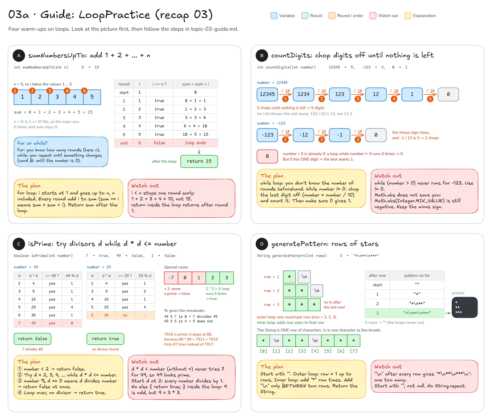

# Topic 3 · Loops: step-by-step guide

This guide walks you through **recap 03 (`LoopPractice`)**. Topic 3 has no main exercise, only this recap.
It gives you pictures, steps and hints, **not finished code**: you still write every method yourself.

**How to use it:** do one method at a time. Look at its picture, follow the steps, write the code,
then run that method's tests. Only when they are green, move on.

## Before you start: four facts

1. A loop checks its condition **before every round**, even the very first one. If the condition is false right
   away, the body runs **0 times**. That is how `sumNumbersUpTo(0)` and `generatePattern(0)` work without any extra
   code. (See [diagram 03](README.md#03--loops) for the 4 phases of a `for` loop.)
2. **`for` or `while`?** Use `for` when you know how many rounds there will be ("add the numbers 1 to n",
   "print 3 rows"). Use `while` when you repeat **until something changes** and you don't know beforehand how
   often ("divide until nothing is left").
3. The operators in plain words:
   - `i++` means `i = i + 1`, and `sum += i` means `sum = sum + i`.
   - `/` between two whole numbers throws the rest away: `7 / 2` is `3`, `123 / 10` is `12` (not 12.3).
   - `%` gives that rest (the remainder): `7 % 2` is `1`, `49 % 5` is `4`, `49 % 7` is `0`.
     So `a % b == 0` means "b divides a evenly".
4. Most loop bugs are **off by one**: the loop runs one round too many or too few (`<` versus `<=`).
   Always check the **first** and the **last** round with a small example.

```java
for (int i = 1; i <= 3; i++) {   // i = 1, 2, 3: you know the number of rounds
    System.out.println(i);
}

int x = 100;
while (x > 1) {                   // repeat until x is no longer bigger than 1
    x = x / 2;                    // 100 → 50 → 25 → 12 → 6 → 3 → 1
}                                 // something in the body MUST change x, or the loop never ends
```

---

## Recap 03: `LoopPractice`

You write: `src/main/java/sk/upjs/paz1a/tutoring/recap/exercise03/LoopPractice.java`. Tests: `LoopPracticeTest`.
The checks for a negative `n` and negative `rows` (the `throw` lines at the top) are already written for you,
so you only write the loops.



### A · `sumNumbersUpTo`: add 1 + 2 + ... + n

**Goal:** `5` → `15` (because 1 + 2 + 3 + 4 + 5 = 15), `1` → `1`, `100` → `5050`, `0` → `0`.

1. Make a variable for the running total. What should it start at, so that adding nothing gives `0`?
2. A `for` loop, because you know how many rounds there are: `i` starts at `1` and must reach `n` **itself**.
3. Every round: add `i` to the total.
4. After the loop has finished, return the total.

Fill in the blanks:

```java
int sum = ___;
for (int i = ___; i ___ n; i++) {   // which comparison lets i become n?
    sum += ___;                      // the same as: sum = sum + ___;
}
return ___;
```

Trace it with the table in the picture: after round 5, `sum` is `15` and `i` becomes `6`. Now `6 <= 5` is false,
so the loop ends. For `n = 0` the very first check `1 <= 0` is already false: the loop runs 0 times and you
return the start value.

**Check:** run `LoopPracticeTest`: `sumUpToOne`, `sumUpToFive`, `sumUpToHundred`, `sumUpToZeroIsZero` and
`negativeLimitIsRejected` should be green.

**Common mistakes**
- `i < n`: the last round is missing, so `5` gives `10` and `1` gives `0`.
- `return sum;` inside the loop: the method stops after round 1.
- Starting the total at `1` instead of `0`: every answer is one too big.

### B · `countDigits`: chop digits off until nothing is left

**Goal:** `12345` → `5`, `7` → `1`, `9` → `1`, `10` → `2`, `-123` → `3` (the minus sign is not a digit), `0` → `1`,
and both `Integer.MAX_VALUE` (`2147483647`) and `Integer.MIN_VALUE` (`-2147483648`) → `10`.

This is a `while` loop: you don't know beforehand how many rounds it takes, because that number is exactly
what you are counting.

1. A counter that starts at `0`.
2. While the number is **not 0** (`!=` means "is not equal to"): chop its last digit off with
   `number = number / 10`, and add 1 to the counter. (You may change the parameter `number` inside the method.)
3. After the loop, return the counter.
4. Now test `0` in your head: it is already `0`, so the loop runs 0 times and you return `0`. But `0` has one
   digit! Fix it: either handle `0` with an `if` **before** the loop, or use a `do { ... } while (...);` loop,
   whose body always runs at least once.

The chop chain for a negative number, round by round (Java's `/` cuts towards 0, so the minus sign stays):

| round | number before | number / 10 | counter |
|-------|---------------|-------------|---------|
| 1     | `-123`        | `-12`       | 1       |
| 2     | `-12`         | `-1`        | 2       |
| 3     | `-1`          | `0`         | 3       |
| check | `0`           | `0 != 0` is false, the loop ends | **3** |

**Check:** `zeroHasOneDigit`, `singleDigit`, `nineHasOneDigitAndTenHasTwo`, `severalDigits`,
`minusSignIsNotADigit`, `extremeValues`.

**Common mistakes**
- `while (number > 0)`: for `-123` the condition is false right away and you return `0`.
  The test tells you: "Loop while the number is != 0, not while it is > 0".
- Making the number positive first with `Math.abs(number)` or `-number`. The biggest `int` is `2147483647`,
  so `+2147483648` does not exist: `Math.abs(Integer.MIN_VALUE)` gives back the same **negative** number, and a
  `> 0` loop fails `extremeValues`. You don't need it at all: `/ 10` works on negative numbers too.
- Forgetting step 4: `zeroHasOneDigit` fails.
- Turning the number into a String and counting its characters: `-123` has 4 characters (the minus sign
  counts), and this recap is about writing the loop.

### C · `isPrime`: try divisors while `d * d <= number`

**Goal:** `2`, `3`, `5`, `7` and `7919` → `true`. `4`, `9`, `25`, `49`, `100` and `7917` (= 3 · 7 · 13 · 29) → `false`.
`0`, `1`, `-2` and `-7` → `false`.

A prime is a number **greater than 1** that only 1 and the number itself divide evenly. In Java,
"d divides number" is `number % d == 0` (the remainder is 0).

1. **Special case first:** a number below 2 is never a prime → return `false`.
2. Try the possible divisors `d = 2, 3, 4, ...` one by one.
3. If `d` divides the number, you know the answer already: return `false` right away. If not, do nothing:
   the loop simply goes on to the next `d`.
4. When do you stop? You only need to try `d` while `d * d <= number` (the Javadoc hint).
5. The loop has ended and no `d` divided the number → return `true`.

**Why the square root is enough:** divisors come in pairs. `100 = 2 · 50 = 4 · 25 = 5 · 20 = 10 · 10`. In every
pair, one of the two numbers is at most `10`, and `10 · 10 = 100`. So if no `d` with `d * d <= number` divides it,
no bigger `d` will either. For `7919` you try `d = 2 … 88` (because `89 * 89 = 7921` is too big): 87 tries
instead of 7917. A loop that goes all the way to `number - 1` also passes the tests, but do try the short one.

Look at `2` and `3` in the picture: `2 * 2 = 4` is already bigger than both, so the loop runs 0 times and you
return `true`. They need no special case.

**Check:** `smallPrimes`, `evenNumbersAboveTwoAreNotPrime`, `squaresOfPrimesAreNotPrime`,
`largerPrimeAndLargerComposite`, `zeroAndOneAreNotPrime`, `negativeNumbersAreNotPrime`.

**Common mistakes**
- `d * d < number` (without the `=`): `49` is never tried with `d = 7`, so it looks prime. The test asks:
  "Did you try divisors up to AND including the square root?"
- Starting at `d = 1`: `1` divides every number, so nothing is a prime.
- An `else { return true; }` inside the loop: `9 % 2` is `1`, so `9` would be "prime" after the first try.
  You only know "prime" after **all** tries, so `return true` belongs after the loop.
- Forgetting step 1: for `1`, `0` and negative numbers the loop runs 0 times and you would return `true`.

### D · `generatePattern`: rows of stars

**Goal:** `3` → `"*\n**\n***"`, `1` → `"*"`, `5` → five rows, `0` → `""` (an empty String). Printed, `3` looks like:

```
*
**
***
```

`"\n"` is **one** character: the line break. You type two keys, but it is a single character, and when the
String is printed, everything after it starts on a new line. `+` glues Strings together: `"**" + "*"` is `"***"`.

1. Start with an empty String `""`.
2. **Outer** `for` loop: one round per row, `row` from `1` up to `rows` (included).
3. **Inner** `for` loop: adds one `"*"` per round. How many rounds? As many as the row number.
4. The line break goes **between** two rows: there is none after the last row (and none before the first).
   Decide where you add it, and use an `if` so that it is skipped once.
5. After both loops, return the String.

The table in the picture shows the String after every row: `""` → `"*"` → `"*\n**"` → `"*\n**\n***"`.
With `rows = 0` the outer loop runs 0 times and you return `""`, with no extra code.

**Check:** `threeRows`, `oneRow`, `fiveRows`, `zeroRowsGiveEmptyString`, `negativeRowsAreRejected`.

**Common mistakes**
- A `"\n"` after **every** row: you return `"*\n**\n***\n"`, one line break too many, and `threeRows` fails.
  (In the test output the two Strings look almost the same: look at the very end.)
- Row 1 with 0 or 2 stars: check the first and the last round of the inner loop (`<` versus `<=`).
- Starting with `null` instead of `""`: `null + "*"` gives `"null*"`.
- Using `String.repeat`: the Javadoc asks for two nested loops.

---

**Still stuck?** Trace your code on paper with the **smallest** test input: `sumNumbersUpTo(1)`, `countDigits(0)`
and `countDigits(10)`, `isPrime(4)` and `isPrime(9)`, `generatePattern(1)`. Write down every variable after every
loop round, like the tables in the picture. Most loop bugs live in the first or the last round.
