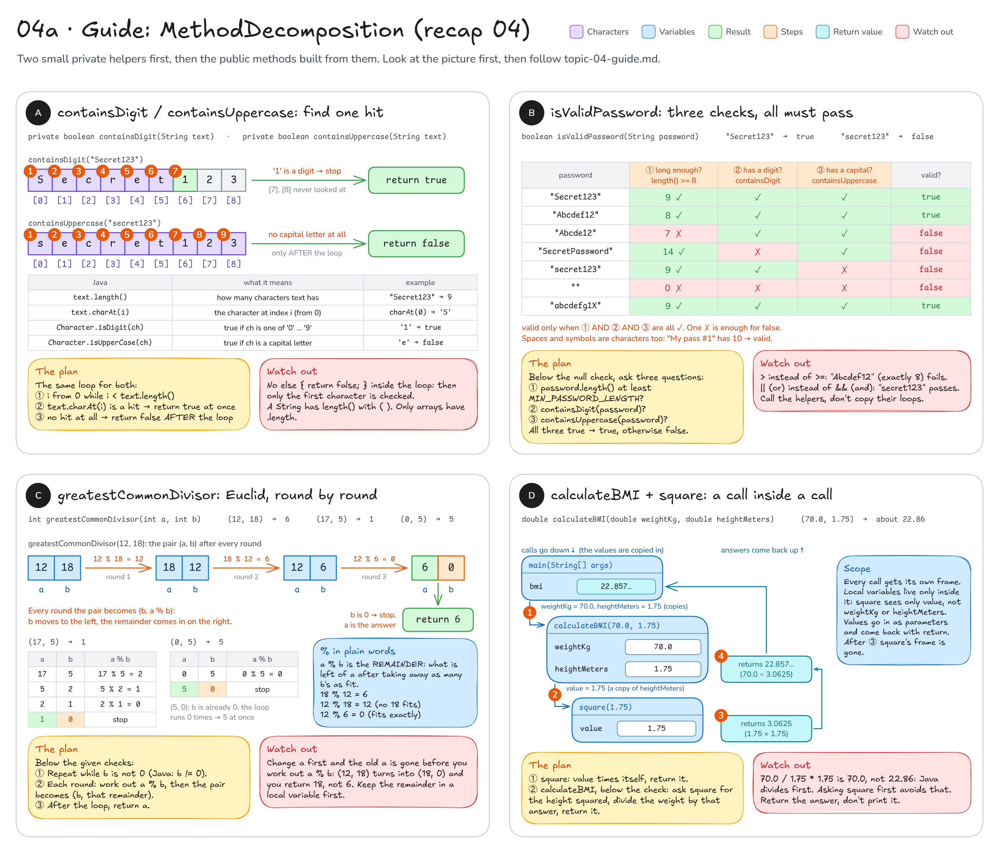

# Topic 4 · Methods & scope: step-by-step guide

This guide walks you through **recap 04 (`MethodDecomposition`)**. Topic 4 has no main exercise, only this recap.
It gives you pictures, steps and hints, **not finished code**: you still write every method yourself.

**How to use it:** do one card at a time, in the order A, B, C, D. Look at its picture, follow the steps, write
the code, then run the tests named under **Check**. Only when they are green, move on.

## Before you start: four facts

1. A **method** is a small named piece of code. It gets values through its **parameters** and gives one value
   back with **`return`**. `return` also ends the method at once: nothing after it runs.
2. A **local variable** (declared inside a method, parameters included) exists only while that method runs, and
   no other method can see it. Every call gets its own private box for them, a *stack frame*.
   See [diagram 04](README.md#04--methods--the-call-stack) for the picture.
3. The `private` helpers (`containsDigit`, `containsUppercase`, `square`) can only be called from inside
   `MethodDecomposition`. No test calls them directly: they are tested **through** the public methods that use them.
   So write the small helper first, then the public method that calls it, then run the tests.
4. A `String` is a row of characters with indexes from `0` to `text.length() - 1`, just like an array.
   `text.charAt(i)` gives you the character at index `i`. One character is a `char`, written in single quotes:
   `'S'`, `'1'`. Careful: for a String, `length()` has brackets.

```java
for (int i = 0; i < text.length(); i++) {   // i = 0, 1, ..., text.length() - 1
    char ch = text.charAt(i);                // the character at index i
    // ... do something with ch
}
```

---

## Recap 04: `MethodDecomposition`

You write: `src/main/java/sk/upjs/paz1a/tutoring/recap/exercise04/MethodDecomposition.java`.
Tests: `MethodDecompositionTest`. The checks for wrong inputs (`null`, negative numbers, ...) are already written
at the top of the public methods: keep them and write your code **below** them.



### A · `containsDigit` and `containsUppercase`: find one hit

**Goal:** `containsDigit("Secret123")` → `true` (the `'1'` at index 6), `containsDigit("SecretPassword")` → `false`,
`containsUppercase("secret123")` → `false`, `containsUppercase("abcdefg1X")` → `true` (the `X` is the very last
character). An empty text `""` has no characters at all → `false` for both.

The Java you need, in plain words:

| Java | What it means | Example |
|------|---------------|---------|
| `text.length()` | how many characters `text` has | `"Secret123".length()` is `9` |
| `text.charAt(i)` | the character at index `i` (counting from 0) | `"Secret123".charAt(0)` is `'S'` |
| `Character.isDigit(ch)` | `true` if `ch` is one of `'0'` … `'9'` | `Character.isDigit('1')` is `true` |
| `Character.isUpperCase(ch)` | `true` if `ch` is a capital letter | `Character.isUpperCase('e')` is `false` |

Steps for `containsDigit`:

1. Loop over every index `i` of `text`: from `0` while `i < text.length()`.
2. Take the character at that index with `text.charAt(i)`.
3. Ask Java whether it is a digit: `Character.isDigit(...)` answers `true` or `false`.
   If it is a digit, you already know the answer: return `true` right away (the loop stops there).
4. If it is not a digit, do nothing: the loop simply goes on to the next character.
5. Only **after** the loop (no character was a digit) return `false`.

Fill in the blanks:

```java
for (int i = 0; i < text.length(); i++) {
    if (___) {          // is the character at index i a digit?
        return ___;
    }
}
return ___;             // we only get here if no character was a digit
```

`containsUppercase` is the same method with **one** change: the question in step 3 is `Character.isUpperCase(...)`.

**Check:** the helpers are private, so no test calls them directly. They are tested through `isValidPassword`
in card B, above all by `validPassword`, `digitAndUppercaseMayBeAnywhere`, `passwordWithoutDigitIsInvalid` and
`passwordWithoutUppercaseIsInvalid`. Want to try them right now? Add a temporary `main` method to `MethodDecomposition`, run it,
and delete it afterwards:

```java
public static void main(String[] args) {
    System.out.println(containsDigit("Secret123"));       // should print true
    System.out.println(containsUppercase("secret123"));   // should print false
}
```

**Common mistakes**
- An `else { return false; }` inside the loop: the method decides after looking at the **first** character only.
  `digitAndUppercaseMayBeAnywhere` then says "Check every character, not just the first one".
- `text.length` without brackets does not compile: for a String it is a method, `text.length()`.
  (Only arrays use `.length` without brackets.)
- `i <= text.length()`: one round too many. `"Secret123".charAt(9)` does not exist and throws a
  `StringIndexOutOfBoundsException`.

### B · `isValidPassword`: three checks, all must pass

**Goal:** `"Secret123"` → `true`, `"Abcdef12"` → `true` (exactly 8 characters is enough), `"Abcde12"` → `false`
(only 7), `"SecretPassword"` → `false` (no digit), `"secret123"` → `false` (no capital letter), `""` → `false`,
`"My pass #1"` → `true` (spaces and `#` are characters too, so it has 10). `null` is already rejected for you.

1. Keep the `null` check at the top.
2. Question ①: is the password long enough? Compare `password.length()` with the constant `MIN_PASSWORD_LENGTH`
   (it is 8). "At least 8" means that 8 itself is fine.
3. Question ②: ask your helper. `containsDigit(password)` answers `true` or `false`.
4. Question ③: ask `containsUppercase(password)`.
5. The password is valid only when **all three** answers are `true`. How do you join three `boolean` values so that
   the result is `true` only when every one of them is `true`? (Java's "and" is `&&`: see
   [diagram 02](README.md#02--conditions--short-circuit).)
   Return that result.

The table in the picture shows the three answers for the test passwords. A single ✗ in a row is enough for `false`.

**Check:** `validPassword`, `exactlyEightCharactersAreEnough`, `sevenCharactersAreTooFew`,
`passwordWithoutDigitIsInvalid`, `passwordWithoutUppercaseIsInvalid`, `digitsOnlyIsInvalid`, `emptyPasswordIsInvalid`,
`digitAndUppercaseMayBeAnywhere`, `spacesAndSymbolsAreAllowed`, `nullPasswordIsRejected`.

Don't be fooled: the tests that expect `false` are green from the very start, because the unfinished method always
returns `false`. They only prove something once `validPassword` is green as well.

**Common mistakes**
- `>` instead of `>=`: `"Abcdef12"` (exactly 8) is rejected and `exactlyEightCharactersAreEnough` fails.
- `||` ("or") instead of `&&` ("and"): one good answer is then enough, so `"secret123"` passes and
  `passwordWithoutUppercaseIsInvalid` fails.
- Writing the loops again inside `isValidPassword` instead of calling the helpers. It can work, but the whole point
  of this recap is to reuse them (the TODO says so).

### C · `greatestCommonDivisor`: Euclid, round by round

**Goal:** `(12, 18)` → `6`, `(18, 12)` → `6`, `(17, 5)` → `1`, `(7, 7)` → `7`, `(100, 25)` → `25`,
`(0, 5)` → `5` and `(5, 0)` → `5`. Negative numbers and `(0, 0)` are already rejected by the given checks.

The greatest common divisor is the biggest number that divides both numbers without a remainder: 6 divides both
12 and 18, and nothing bigger does. The Javadoc gives you the recipe (Euclid's algorithm): **while `b` is not 0,
replace the pair `(a, b)` with `(b, a % b)`; when `b` reaches 0, `a` is the answer.**

`a % b` is the **remainder** of whole-number division, what is left of `a` after taking away as many `b`'s as fit:
`18 % 12` is `6` (12 fits once into 18, 6 is left), `12 % 18` is `12` (18 does not fit into 12 at all, so all of
12 is left), `12 % 6` is `0` (6 fits exactly twice).

1. Below the two given checks, repeat **while `b` is not 0**. In Java, "is not equal to" is written `!=`.
   You don't know in advance how many rounds it takes, so use a `while` loop (see
   [diagram 03](README.md#03--loops)).
2. One round turns the pair `(a, b)` into `(b, a % b)`. Both new values need the **old** `a` and `b`, so work out
   the remainder **first** and keep it in a new local variable. Only then change `a` and `b`.
3. Compare your rounds with the picture: `(12, 18)` → `(18, 12)` → `(12, 6)` → `(6, 0)`.
4. After the loop `b` is 0. Return `a`.

You may change `a` and `b` inside the method: parameters are the method's own copies, so the caller's numbers stay
as they were.

**Check:** `gcdOfTwelveAndEighteen`, `orderOfArgumentsDoesNotMatter`, `coprimeNumbers`, `sameNumbers`,
`oneNumberDividesTheOther`, `zeroAndANumber`, `negativeNumbersAreRejected`, `twoZerosAreRejected`.

**Common mistakes**
- Changing `a` before you work out the remainder: then `a % b` uses the new `a`. `(12, 18)` turns into `(18, 0)`
  and you return 18 instead of 6.
- `if` instead of `while`: an `if` does one round only, so `(12, 18)` returns 18.
- Returning `b` after the loop: it is always 0 there.
- Extra code for "a is smaller than b" or for `(0, 5)` / `(5, 0)`: not needed. The first round already swaps
  `(12, 18)` into `(18, 12)`, and the picture shows that the zero cases work with the plain loop.

### D · `square` and `calculateBMI`: a call inside a call

**Goal:** `calculateBMI(70.0, 1.75)` → about `22.857`, `calculateBMI(50.0, 2.0)` → `12.5`,
`calculateBMI(100.0, 2.0)` → `25.0`. Zero or negative inputs are already rejected by the given check.
The Javadoc formula: **BMI = weight divided by height squared** ("squared" = multiplied by itself).

1. Start with the helper `square`: it gets one number, `value`, and returns that number multiplied by itself.
   `square(1.75)` → `3.0625`, `square(2.0)` → `4.0`.
2. In `calculateBMI`, below the check, call `square` with the height. It gives you back the height squared
   (`3.0625` for 1.75 m). You can keep that answer in a local variable with a clear name, or use the call directly
   in the calculation: both work.
3. Divide the weight by the height squared: `70.0 ÷ 3.0625 = 22.857…`. Return the result.

Follow the call stack in the picture: ① `calculateBMI(70.0, 1.75)` gets a new frame in which `weightKg` is `70.0` and
`heightMeters` is `1.75`. ② It calls `square(1.75)`, which gets its own frame with `value = 1.75`. ③ `square` returns
`3.0625` and its frame disappears. ④ `calculateBMI` returns `22.857…` to its caller. In the tests, the test method
(for example `typicalBmi`) plays the part of `main`.

Inside `square` you cannot use `weightKg` or `heightMeters`: they live in `calculateBMI`'s frame. `square` knows only
its parameter `value`. That is why the height is passed in as an argument.

**Check:** `typicalBmi`, `exactValues`, `zeroOrNegativeWeightIsRejected`, `zeroOrNegativeHeightIsRejected`.

**Common mistakes**
- Forgetting to replace the `return 0.0;` in `square`: `calculateBMI` then divides by `0.0` and returns `Infinity`
  (the test reports `but was: <Infinity>`).
- Writing the division without the helper as `70.0 / 1.75 * 1.75`: Java does `/` and `*` from left to right, so that
  is `(70.0 / 1.75) * 1.75 = 70.0`, not 22.86. Asking `square` first avoids this trap.
- Printing the result with `System.out.println` instead of returning it: the caller gets nothing back.

---

**Still stuck?** Make the computer show you what happens: add a temporary `System.out.println` that prints the
variables, for example `a` and `b` at the start of every round in `greatestCommonDivisor`, and compare the output with
the pictures. Or trace the smallest test input on paper, one row per round. Delete the print lines when the tests pass.
