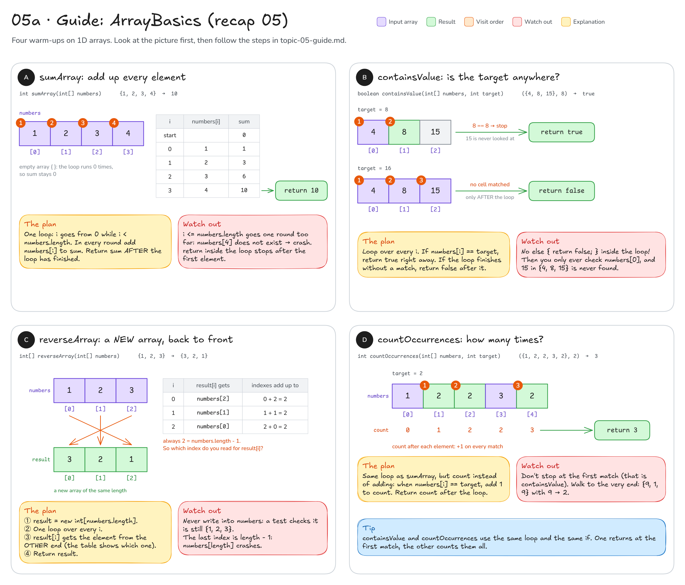
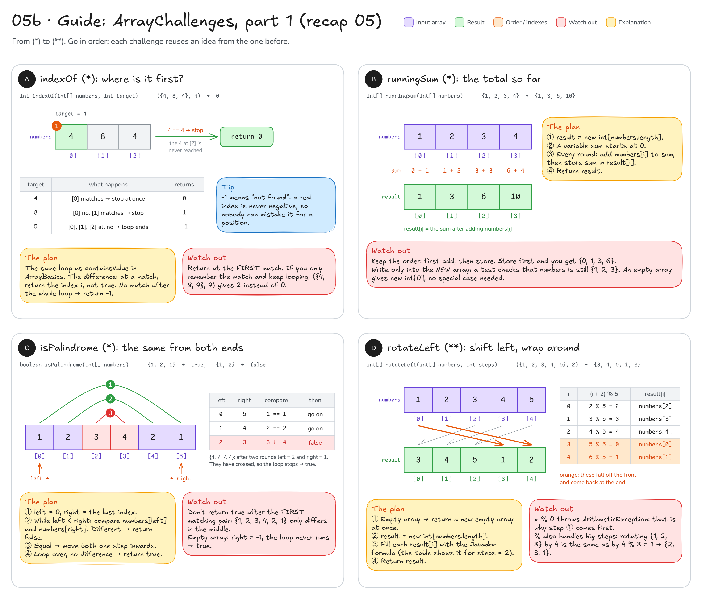
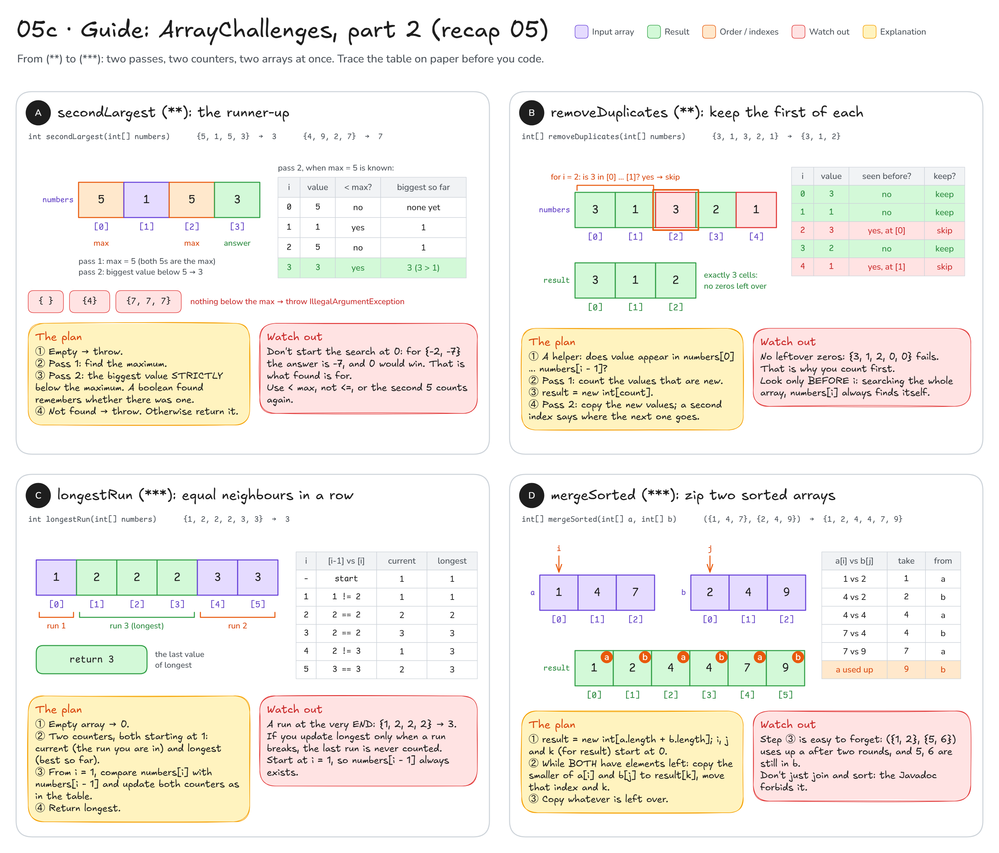
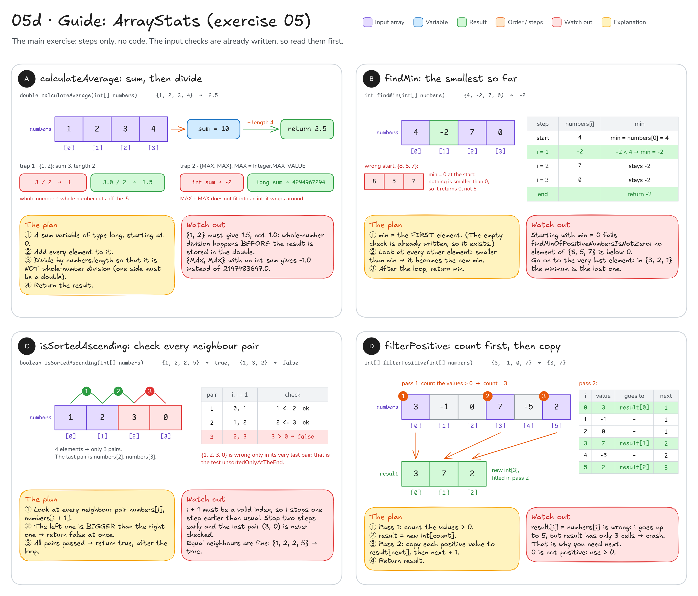

# Topic 5 · 1D arrays: step-by-step guide

This guide walks you through **recap 05 (`ArrayBasics`, then `ArrayChallenges`)** and **exercise 05 (`ArrayStats`)**.
It gives you pictures, steps and hints, **not finished code**: you still write every method yourself.

**How to use it:** do one method at a time. Look at its picture, follow the steps, write the code,
then run that method's tests. Only when they are green, move on.

## Before you start: four facts

1. `numbers.length` is the number of elements. The indexes go from `0` to `numbers.length - 1`, so a loop over
   the whole array runs **while `i < numbers.length`**. (See [diagram 05](README.md#05--arrays) for the picture.)
2. An **empty** array (`new int[0]`) is not `null`: it is a real array with length 0, and a loop over it simply
   runs 0 times. `null` is rejected by the checks that are already written for you.
3. "Return a **new** array" means: create it with `new int[...]`, fill it, return it. Never change the input array,
   and never return the input itself. Several tests check exactly that.
4. No `java.util.Arrays`, no streams: the point is to write the loops yourself.

```java
for (int i = 0; i < numbers.length; i++) {   // i = 0, 1, ..., numbers.length - 1
    // ... do something with numbers[i]
}
```

---

## Part 1 · Recap 05: `ArrayBasics`

You write: `src/main/java/sk/upjs/paz1a/tutoring/recap/exercise05/ArrayBasics.java`. Tests: `ArrayBasicsTest`.
The `null` check is already written for you (`requireNonNull`), so you only write the logic.



### A · `sumArray`: add up every element

**Goal:** `{1, 2, 3, 4}` → `10`, `{5, -8, 1}` → `-2`. An empty array → `0`.

1. Make a variable for the running total. What should it start at?
2. One loop: `i` from `0` while `i < numbers.length`.
3. Inside: add `numbers[i]` to the total.
4. After the loop has finished, return the total.

Fill in the blanks:

```java
int sum = ___;
for (int i = 0; i < ___; i++) {
    sum += ___;
}
return ___;
```

**Check:** run `ArrayBasicsTest`: `sumOfSeveralNumbers`, `sumWithNegativeNumbers`, `sumOfSingleElement`,
`sumOfEmptyArrayIsZero` and `sumRejectsNull` should be green.

**Common mistakes**
- `i <= numbers.length`: one round too many, so `numbers[4]` crashes with `ArrayIndexOutOfBoundsException`.
- `return sum;` inside the loop: the method stops after the first element.

### B · `containsValue`: is the target anywhere?

**Goal:** `({4, 8, 15}, 8)` → `true`, `({4, 8, 15}, 16)` → `false`. An empty array contains nothing → `false`.

1. Loop over every index `i`.
2. If `numbers[i]` equals `target`, you know the answer already: return `true` right away.
3. If it does not match, do nothing: the loop simply goes on to the next element.
4. Only **after** the loop (no element matched) return `false`.

**Check:** `findsValueInTheMiddle`, `findsFirstAndLastValue`, `missingValueIsNotFound`, `emptyArrayContainsNothing`,
`findsZeroAndNegativeValues`, `containsRejectsNull`.

**Common mistakes**
- An `else { return false; }` inside the loop: the method decides after looking at `numbers[0]` only.
  `findsFirstAndLastValue` then asks "Does your loop reach the last element?".
- Comparing `i == target`: `i` is the **position**, `numbers[i]` is the **value**.

### C · `reverseArray`: a new array, back to front

**Goal:** `{1, 2, 3}` → `{3, 2, 1}` as a **new** array; `numbers` stays `{1, 2, 3}`. Empty → a new empty array.

1. Create the result array. How long must it be?
2. One loop over every index `i` of the result.
3. `result[i]` gets the element from the **other end** of `numbers`. Look at the table in the picture:
   the two indexes always add up to `numbers.length - 1`. Work out the index you read from that.
4. Return the result.

```java
int[] result = new int[___];             // same length as numbers
for (int i = 0; i < numbers.length; i++) {
    // result[i] = the element from the other end of numbers
}
return result;
```

**Check:** `reversesArrayOfEvenLength`, `reversesArrayOfOddLength`, `singleElementStaysTheSame`,
`emptyArrayGivesEmptyArray`, `returnsNewArrayAndKeepsInputUnchanged`, `reverseRejectsNull`.

**Common mistakes**
- Off by one: for `i = 0` you need the **last** index, which is `length - 1`, not `length` (that one crashes).
- Swapping values inside `numbers`: the input must stay unchanged, so only ever write into `result`.

### D · `countOccurrences`: how many times?

**Goal:** `({1, 2, 2, 3, 2}, 2)` → `3`, `({1, 2, 3}, 7)` → `0`, `({9, 1, 9}, 9)` → `2`.

1. A counter that starts at `0`.
2. Loop over every index `i`.
3. When `numbers[i]` equals `target`, the counter goes up by one.
4. After the loop, return the counter.

It is the loop of `sumArray` and the `if` of `containsValue` put together.

**Check:** `countsRepeatedValue`, `missingValueCountsZero`, `everyElementMatches`, `countsMatchesAtBothEnds`,
`emptyArrayCountsZero`, `countRejectsNull`.

**Common mistakes**
- `return` inside the `if`: you return `1` at the first match.
- `count++` outside the `if`: you count every element and return `numbers.length`.

---

## Part 2 · Recap 05: `ArrayChallenges`

You write: `src/main/java/sk/upjs/paz1a/tutoring/recap/exercise05/ArrayChallenges.java`. Tests: `ArrayChallengesTest`.
Eight extra tasks from (\*) easy to (\*\*\*) hard: go in order. The same rules as in `ArrayBasics`: `null` is
already rejected, an empty array is a valid input, and a method that returns an array returns a **new** one.

### Challenges 1–4 (picture 05b)



### A · `indexOf` (\*): where is it first?

**Goal:** `({4, 8, 4}, 4)` → `0`, `({4, 8, 4}, 8)` → `1`, `({4, 8, 4}, 5)` → `-1`, `({1, 2, 3}, 3)` → `2`.

1. Start from your `containsValue`: the same loop and the same `if`.
2. At a match, return the **position** `i`.
3. After the loop nothing has matched: return `-1`.

**Check:** `indexOfFindsFirstOccurrence`, `indexOfFindsLastElement`, `indexOfMissingValueIsMinusOne`,
`indexOfInEmptyArrayIsMinusOne`, `indexOfRejectsNull`.

**Common mistakes**
- Remembering the match in a variable and looping on: you get the **last** match (`2` instead of `0`).
- `return numbers[i]`: that is the value you were looking for, not where it is.

### B · `runningSum` (\*): the total so far

**Goal:** `{1, 2, 3, 4}` → `{1, 3, 6, 10}`, `{5, -2, -3}` → `{5, 3, 0}`. Empty → a new empty array.

1. Create the result array with the same length as `numbers`.
2. A variable `sum`, starting at `0`, remembers the total so far.
3. Every round: **first** add `numbers[i]` to `sum`, **then** store `sum` in `result[i]`.
4. Return the result.

**Check:** `runningSumOfSeveralNumbers`, `runningSumWithNegativeNumbers`, `runningSumOfSingleElement`,
`runningSumOfEmptyArrayIsEmpty`, `runningSumReturnsNewArrayAndKeepsInput`, `runningSumRejectsNull`.

**Common mistakes**
- Store first, add second: you get `{0, 1, 3, 6}`.
- Writing the sums back into `numbers`: the test checks that the input is unchanged.

### C · `isPalindrome` (\*): the same from both ends

**Goal:** `{1, 2, 1}` → `true`, `{4, 7, 7, 4}` → `true`, `{1, 2}` → `false`, `{}` and `{5}` → `true`.

1. Two indexes: `left` on the first element, `right` on the last one.
2. Repeat while `left < right`: compare the two elements. Different → return `false` at once.
3. Equal → move both one step towards the middle (`left` to the right, `right` to the left).
4. The loop has ended and every pair matched → return `true`.

The table in the picture traces `{1, 2, 3, 4, 2, 1}`: the first two pairs match, the third one (`3` and `4`) does not.

**Check:** `oddLengthPalindrome`, `evenLengthPalindrome`, `twoDifferentValuesAreNotAPalindrome`,
`mismatchInTheMiddleIsFound`, `emptyAndSingleElementArraysArePalindromes`, `isPalindromeRejectsNull`.

**Common mistakes**
- `return true` inside the loop after the first equal pair: `mismatchInTheMiddleIsFound` fails.
- Moving only one of the two indexes: you compare the wrong pairs.

### D · `rotateLeft` (\*\*): shift left, wrap around

**Goal:** `({1, 2, 3, 4, 5}, 2)` → `{3, 4, 5, 1, 2}`, `({1, 2, 3}, 3)` → `{1, 2, 3}`, `({1, 2, 3}, 4)` → `{2, 3, 1}`.
Empty → a new empty array. (The check for negative `steps` is already written.)

1. **Special case first:** an empty array → return a new empty array straight away.
   Why? The formula divides by the length with `%`, and `x % 0` throws an `ArithmeticException`.
2. Create the result array with the same length.
3. Fill every `result[i]` with the formula from the Javadoc hint. Check it against the table in the picture:
   for `steps = 2`, `result[0]` comes from `numbers[2]`, and `result[3]` wraps around to `numbers[0]`.
4. Return the result.

`%` is what makes the index wrap around: `5 % 5 == 0`, `6 % 5 == 1`. It also handles big steps:
rotating 3 elements by 4 is the same as rotating them by `4 % 3 == 1`.

**Check:** `rotateLeftByTwo`, `rotatingByZeroKeepsTheOrder`, `rotatingByTheLengthKeepsTheOrder`,
`stepsLargerThanTheLengthWrapAround`, `rotatingAnEmptyArrayGivesAnEmptyArray`, `rotateReturnsNewArrayAndKeepsInput`,
`rotateRejectsNullAndNegativeSteps`.

**Common mistakes**
- Forgetting step 1: `rotatingAnEmptyArrayGivesAnEmptyArray` fails ("Careful: x % 0 throws an ArithmeticException").
- Rotating the wrong way: check that `result[0]` is `3` for the example, not `4`.

### Challenges 5–8 (picture 05c)



### A · `secondLargest` (\*\*): the runner-up

**Goal:** `{4, 9, 2, 7}` → `7`, `{5, 1, 5, 3}` → `3` (both 5s are the maximum), `{-2, -7, -5}` → `-5`.
`{}`, `{4}` and `{7, 7, 7}` have no second largest value → `IllegalArgumentException`. This check is **your** job.

1. Empty array → throw (there is no first element to start from).
2. **Pass 1:** find the maximum. Start with the first element and keep anything bigger.
3. **Pass 2:** find the biggest value that is **strictly smaller** than the maximum. Instead of a made-up start
   value, use a `boolean found` that starts as `false` and becomes `true` once you have a candidate.
4. After pass 2: nothing found → throw. Otherwise return it.

**Check:** `secondLargestOfDifferentValues`, `duplicatesOfTheMaximumCountOnce`, `secondLargestOfNegativeNumbers`,
`maximumAtTheStartOrTheEnd`, `twoDifferentValues`, `arrayWithoutSecondLargestIsRejected`, `secondLargestRejectsNull`.

**Common mistakes**
- Starting the second search at `0`: for `{-2, -7, -5}` nothing is above 0, so you return 0 instead of -5.
- `<= max` instead of `< max`: the second 5 in `{5, 1, 5, 3}` counts again and you return 5.

### B · `removeDuplicates` (\*\*): keep the first of each

**Goal:** `{3, 1, 3, 2, 1}` → `{3, 1, 2}`, `{5, 5, 5}` → `{5}`, `{1, 2, 3}` → a new `{1, 2, 3}`. Empty → empty.

1. Write a small helper: does a value appear among `numbers[0]` … `numbers[i - 1]`, the cells **before** `i`?
   (The `[i]`-th value is new exactly when the answer is no. The table in the picture does this for every `i`.)
2. **Pass 1:** count the values that are new.
3. Create the result with exactly that many cells.
4. **Pass 2:** walk `numbers` again and copy every new value. A second index tells you where the next one goes
   in the result (it is **not** `i`).
5. Return the result.

**Check:** `removeDuplicatesKeepsFirstOccurrencesInOrder`, `arrayWithoutDuplicatesIsCopied`, `allEqualValuesLeaveOne`,
`removeDuplicatesOfEmptyArrayIsEmpty`, `removeDuplicatesKeepsInputUnchanged`, `removeDuplicatesRejectsNull`.

**Common mistakes**
- A result with leftover zeros at the end (`{3, 1, 2, 0, 0}`): the result must have exactly the right length.
- Searching the **whole** array in step 1: `numbers[i]` always finds itself, so nothing looks new.

### C · `longestRun` (\*\*\*): equal neighbours in a row

**Goal:** `{1, 2, 2, 2, 3, 3}` → `3`, `{1, 2, 2, 2}` → `3`, `{4, 4, 1, 2}` → `2`, `{1, 2, 3}` → `1`, `{5}` → `1`, `{}` → `0`.

1. Empty array → `0`.
2. Two counters: `current` (the length of the run you are in) and `longest` (the best so far).
   What should they start at? (A single element is already a run of length 1.)
3. Walk from `i = 1` and compare every element with its left neighbour. Decide what happens to `current` when
   they are equal and when they differ, then check whether `longest` must change. Trace it with the table in the picture.
4. Return `longest`.

**Check:** `longestRunInTheMiddle`, `longestRunAtTheEnd`, `longestRunAtTheStart`, `noRepeatedNeighbors`,
`allValuesEqual`, `singleElementIsARunOfOne`, `emptyArrayHasNoRun`, `longestRunRejectsNull`.

**Common mistakes**
- Updating `longest` only when a run breaks: the run that reaches the last element is never counted
  (`longestRunAtTheEnd`: "Did you also count the run that reaches the last element?").
- Starting at `i = 0` and reading `numbers[i - 1]`: index `-1` crashes.
- Setting `current` back to `0` when a new run starts: the new element is already a run of 1.

### D · `mergeSorted` (\*\*\*): zip two sorted arrays

**Goal:** `({1, 4, 7}, {2, 3, 8, 9})` → `{1, 2, 3, 4, 7, 8, 9}`, `({1, 4, 4}, {4, 5})` → `{1, 4, 4, 4, 5}`,
`({5, 6}, {1, 2})` → `{1, 2, 5, 6}`. Joining the arrays and sorting them is not allowed.

1. Create the result: it holds all elements of `a` and of `b`.
2. Three indexes, all starting at `0`: `i` (next unused element of `a`), `j` (next unused of `b`),
   `k` (next free cell of the result).
3. While **both** arrays still have unused elements: compare `a[i]` with `b[j]`, copy the smaller one into
   `result[k]`, and move on that array's index and `k`. (Equal? Either one is fine: duplicates are kept anyway.)
4. One array is used up: copy what is left of the other one.
5. Return the result.

**Check:** `mergesTwoSortedArrays`, `mergeKeepsDuplicates`, `mergeWithOneEmptyArray`, `mergeOfTwoEmptyArraysIsEmpty`,
`oneArrayEntirelyBeforeTheOther`, `mergeWithNegativeNumbers`, `mergeRejectsNull`.

**Common mistakes**
- Forgetting step 4: `oneArrayEntirelyBeforeTheOther` fails ("When one array runs out, copy what is left of the other one").
- `||` instead of `&&` in step 3: you read `a[i]` after `a` is used up and crash.
- Forgetting to move `k`: every value lands in `result[0]`.

---

## Part 3 · Exercise 05: `ArrayStats`

You write: `src/main/java/sk/upjs/paz1a/tutoring/exercise05/ArrayStats.java`. Tests: `ArrayStatsTest`.
The input check `requireNonEmpty` is already written: every method may assume an array with **at least one**
element. This is the main exercise, so there are steps but no code templates.



### A · `calculateAverage`: sum, then divide

**Goal:** `{1, 2, 3, 4}` → `2.5`, `{1, 2}` → `1.5`, `{-4, 2, -1}` → `-1.0`,
`{Integer.MAX_VALUE, Integer.MAX_VALUE}` → `2147483647.0`.

1. Add up all elements. Choose the **type** of the sum carefully: two `Integer.MAX_VALUE` do not fit into an `int`.
2. Divide by the number of elements, but not as whole-number division: at least one side must be a `double`
   **before** you divide (remember recap 01: `5 / 9` is `0`).
3. Return the result.

**Check:** `averageOfSeveralNumbers`, `averageIsNotCutByIntegerDivision`, `averageOfNegativeNumbers`,
`averageOfSingleElementIsThatElement`, `averageOfZerosIsZero`, `averageDoesNotOverflowForHugeValues`,
`averageRejectsNullAndEmptyArray`.

**Common mistakes**
- Storing the result in a `double` is not enough: in `double avg = sum / numbers.length;` the division happens first,
  with whole numbers, so `{1, 2}` gives `1.0`. A cast around the whole division comes too late for the same reason.
- An `int` sum: `{MAX, MAX}` wraps around to `-2` and the average becomes `-1.0`.

### B · `findMin`: the smallest so far

**Goal:** `{4, -2, 7, 0}` → `-2`, `{8, 5, 7}` → `5`, `{3, 2, 1}` → `1`, `{Integer.MAX_VALUE, Integer.MIN_VALUE}` → `Integer.MIN_VALUE`.

1. Start `min` with the **first** element (the empty check guarantees it exists).
2. Look at every other element: if it is smaller than `min`, it becomes the new `min`.
3. After the loop, return `min`.

**Check:** `findMinInMixedArray`, `findMinOfPositiveNumbersIsNotZero`, `findMinWhenSmallestIsLast`,
`findMinOfSingleElement`, `findMinWithExtremeValues`, `findMinRejectsNullAndEmptyArray`.

**Common mistakes**
- `min = 0` at the start: for `{8, 5, 7}` nothing is below 0, so you return 0 ("Start with the first element, not with 0").
- `>` instead of `<`: that finds the maximum.

### C · `isSortedAscending`: check every neighbour pair

**Goal:** `{1, 2, 5, 9}` → `true`, `{1, 2, 2, 5}` → `true` (equal neighbours are fine), `{5}` → `true`,
`{1, 3, 2, 4}` → `false`, `{1, 2, 3, 0}` → `false`.

1. Go through every neighbour pair `numbers[i]`, `numbers[i + 1]`. An array with 4 elements has only 3 pairs:
   where must `i` stop so that `i + 1` is still a valid index?
2. If the left element is **bigger** than the right one → return `false` at once.
3. After the loop (all pairs were fine) → return `true`. A single element has no pairs, so the loop never runs.

**Check:** `sortedArrayIsSorted`, `equalNeighboursAreAllowed`, `allEqualValuesAreSorted`, `singleElementIsSorted`,
`unsortedInTheMiddle`, `unsortedOnlyAtTheEnd`, `unsortedOnlyAtTheStart`, `descendingArrayIsNotSorted`,
`isSortedRejectsNullAndEmptyArray`.

**Common mistakes**
- The usual `i < numbers.length`: in the last round `numbers[i + 1]` crashes.
- Stopping one pair too early: `unsortedOnlyAtTheEnd` fails ("Did your loop compare the last pair?").
- `>=` instead of `>`: equal neighbours wrongly count as unsorted.

### D · `filterPositive`: count first, then copy

**Goal:** `{3, -1, 0, 7, -5, 2}` → `{3, 7, 2}`, `{0, 0}` → `{}` (0 is not positive), `{-3, -1}` → `{}` (empty, not `null`).

1. **Pass 1:** count how many values are greater than 0.
2. Create the result with exactly that many cells.
3. **Pass 2:** walk `numbers` again. Every positive value goes into the next free cell of the result.
   You need a second index for that (`next` in the picture), because `i` runs over `numbers`, not over the result.
4. Return the result.

**Check:** `filterKeepsPositiveValuesInOrder`, `zeroIsNotPositive`, `noPositiveValuesGiveEmptyArrayNotNull`,
`allPositiveValuesAreCopiedIntoNewArray`, `filterOfSinglePositiveElement`, `filterDoesNotChangeTheInput`,
`filterRejectsNullAndEmptyArray`.

**Common mistakes**
- `result[i] = numbers[i]`: `i` goes up to 5 but the result has only 3 cells → `ArrayIndexOutOfBoundsException`.
- `>= 0`: `zeroIsNotPositive` fails.
- Returning `numbers` when every value is positive: the test wants a new array.

---

**Still stuck?** Trace your code on paper with the **smallest** test input: write down `i` and every variable
after every loop round, and compare with the tables in the pictures. Most array bugs live in the first or the
last round (`<` versus `<=`, `i - 1`, `i + 1`).
