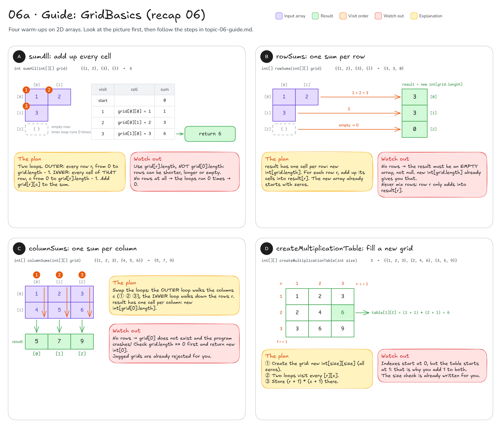
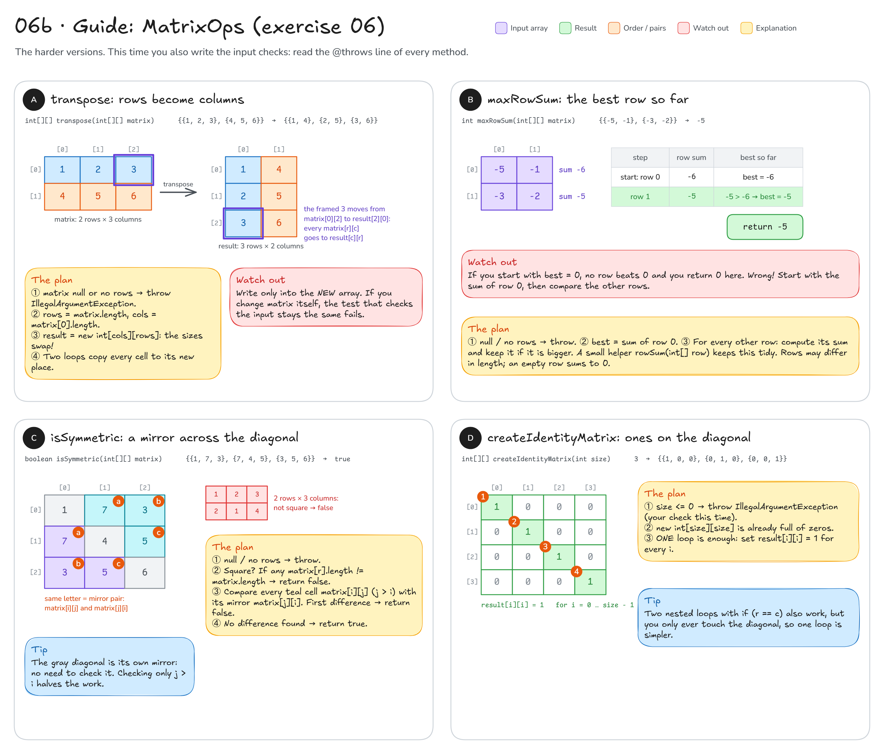

# Topic 6 · 2D arrays: step-by-step guide

This guide walks you through **recap 06 (`GridBasics`)** and **exercise 06 (`MatrixOps`)**.
It gives you pictures, steps and hints, **not finished code**: you still write every method yourself.

**How to use it:** do one method at a time. Look at its picture, follow the steps, write the code,
then run that method's tests. Only when they are green, move on.

## Before you start: three facts

1. A 2D array is an **array of rows**. `grid[r]` is row `r` (an `int[]` of its own), `grid[r][c]` is the value in
   row `r`, column `c`. Always **row first, then column**.
2. `grid.length` is the number of rows. `grid[r].length` is the number of cells **in row r**.
   Rows may have different lengths.
3. To visit every cell you need two loops: the outer one walks the rows, the inner one walks the cells of the
   current row. (See [diagram 06](README.md#06--2d-arrays) for the picture.)

```java
for (int r = 0; r < grid.length; r++) {          // every row
    for (int c = 0; c < grid[r].length; c++) {   // every cell of THIS row
        // ... do something with grid[r][c]
    }
}
```

---

## Part 1 · Recap 06: `GridBasics`

You write: `src/main/java/sk/upjs/paz1a/tutoring/recap/exercise06/GridBasics.java`. Tests: `GridBasicsTest`.
The `null` checks are already written for you (`requireNonNull`, `requireRectangular`), so you only write the logic.



### A · `sumAll`: add up every cell

**Goal:** `{{1, 2}, {3}, {}}` → `6`. A grid with no rows → `0`.

1. Make a variable for the running total. What should it start at?
2. Outer loop: every row `r`, from `0` while `r < grid.length`.
3. Inner loop: every cell `c` of **that** row, while `c < grid[r].length`.
4. Inside: add `grid[r][c]` to the total.
5. After **both** loops have finished, return the total.

Fill in the blanks:

```java
int sum = ___;
for (int r = 0; r < ___; r++) {
    for (int c = 0; c < ___; c++) {
        sum += ___;
    }
}
return ___;
```

**Check:** run `GridBasicsTest`: `sumOfRectangularGrid`, `sumOfJaggedGrid`, `sumWithNegativeNumbers`,
`sumOfOneByOneGrid` and `gridWithoutRowsSumsToZero` should be green.

**Common mistakes**
- Inner loop with `grid[0].length`: works for rectangles, but crashes or skips cells on the jagged grid.
- `return sum;` inside a loop: the method stops after the first cell.

### B · `rowSums`: one sum per row

**Goal:** `{{1, 2}, {3}, {}}` → `{3, 3, 0}`. No rows → an **empty** array (not `null`).

1. Create the result array. How many cells does it need? (One per **row**.)
2. For every row `r`: add up the cells of that row, exactly like the inner loop of `sumAll`.
3. Put that row's total into `result[r]`.
4. Return the result.

```java
int[] sums = new int[___];               // one cell per row
for (int r = 0; r < grid.length; r++) {
    // add up the cells of row r and store the total in sums[r]
}
return sums;
```

Two ways to do step 2–3: a local `int sum` that you **set back to 0 at the start of every row**,
or adding straight into `sums[r]` (a new `int` array already starts with zeros).

**Check:** `rowSumsOfRectangularGrid`, `rowSumsOfJaggedGrid`, `rowSumsOfGridWithoutRowsIsEmpty`.

**Common mistakes**
- `int sum = 0;` written **before** the outer loop: the sums keep growing (`{6, 21}` instead of `{6, 15}`).
- `return null` for a grid without rows: the test wants an empty array.

### C · `columnSums`: one sum per column

**Goal:** `{{1, 2, 3}, {4, 5, 6}}` → `{5, 7, 9}`. No rows → empty array. (Jagged grids are already rejected.)

1. **Special case first:** if the grid has no rows, return an empty array right away.
   Why? The next step asks `grid[0]` for the number of columns, and with no rows there is no `grid[0]`.
2. Number of columns = `grid[0].length` (all rows are equally long here). Create the result: one cell per column.
3. Swap the loops: the **outer** loop walks the columns `c`, the **inner** loop walks down the rows `r`.
4. Inside: add `grid[r][c]` to `result[c]`.
5. Return the result.

Trace it on paper first: column 0 → `1 + 4 = 5`, column 1 → `2 + 5 = 7`, column 2 → `3 + 6 = 9`.

**Check:** `columnSumsOfRectangularGrid`, `columnSumsOfSingleRow`, `columnSumsOfSingleColumn`,
`columnSumsOfGridWithoutRowsIsEmpty`.

**Common mistakes**
- Forgetting step 1: `columnSumsOfGridWithoutRowsIsEmpty` fails with `ArrayIndexOutOfBoundsException`.
- Writing `grid[c][r]` because the column loop is outside. It is still **`grid[row][column]`**: only the loop
  order changed, not the meaning of the indexes.

### D · `createMultiplicationTable`: fill a new grid

**Goal:** `3` → `{{1, 2, 3}, {2, 4, 6}, {3, 6, 9}}`. (The size check is already written.)

1. Create a new `size × size` grid. It starts full of zeros.
2. Two loops visit every row `r` and every column `c`.
3. Store the product of the row number and the column number. Careful: indexes start at **0**, the table starts at **1**.
4. Return the grid.

**Check:** `multiplicationTableOfSizeThree`, `multiplicationTableOfSizeOne`, `multiplicationTableOfSizeTenHasAllProducts`.

**Common mistakes**
- `r * c`: the whole first row and column become 0. The picture shows why you need `+ 1`.
- `r <= size`: one step too far → `ArrayIndexOutOfBoundsException`.

---

## Part 2 · Exercise 06: `MatrixOps`

You write: `src/main/java/sk/upjs/paz1a/tutoring/exercise06/MatrixOps.java`. Tests: `MatrixOpsTest`.
These are the harder versions, and this time **the input checks are your job**.



**The input check** for `transpose`, `maxRowSum` and `isSymmetric` (read their `@throws` lines):
a `null` matrix or a matrix with no rows must be rejected.

```java
if (___ || ___) {
    throw new IllegalArgumentException("The matrix must not be null or empty");
}
```

Write it once as a small private helper method and call it at the start of all three
(`GridBasics` does exactly that with `requireNonNull`, so look there for the pattern).
Order matters inside the `if`: check for `null` **first**, because `matrix.length` on `null` crashes.

### A · `transpose`: rows become columns

**Goal:** `{{1, 2, 3}, {4, 5, 6}}` → `{{1, 4}, {2, 5}, {3, 6}}`, as a **new** matrix.

1. Input check.
2. Remember the sizes: `rows = matrix.length`, `cols = matrix[0].length`.
3. Create the result with **swapped** sizes: it has `cols` rows and `rows` columns.
4. Two loops over every `r` and `c` of the input: copy `matrix[r][c]` to its mirrored place in the result.
   (In the picture, the framed 3 moves from `[0][2]` to `[2][0]`.)
5. Return the result, and never write into `matrix`.

**Check:** all five `transpose…` tests, including `transposeReturnsNewMatrixAndKeepsInputUnchanged`,
plus `transposeRejectsNullAndEmptyMatrix`.

**Common mistakes**
- `new int[rows][cols]`: works for square matrices only, fails for the 2×3 example.
- Changing the input "in place": the test checks that the original matrix is unchanged.

### B · `maxRowSum`: the best row so far

**Goal:** the largest sum of a single row. `{{-5, -1}, {-3, -2}}` → `-5`.

1. Input check.
2. Write a small helper that returns the sum of one `int[]` row (an empty row → 0).
3. Start with `best` = the sum of **row 0**.
4. For every other row: compute its sum; if it is bigger than `best`, it becomes the new `best`.
5. Return `best`.

| step | row sum | best so far |
|------|---------|-------------|
| start: row 0 | -6 | -6 |
| row 1 | -5 | -5 > -6, so **-5** |

**Check:** `maxRowSumPicksTheLargestRow`, `maxRowSumWhenLastRowIsLargest`, `maxRowSumWithOnlyNegativeRows`,
`maxRowSumWithRowsOfDifferentLengths`, `maxRowSumOfOneByOneMatrix`, `maxRowSumOfZeroMatrixIsZero`.

**Common mistakes**
- `best = 0` at the start: with only negative rows nothing beats 0, so you return 0 instead of -5.
- Using `matrix[0].length` for every row: rows can have different lengths here.

### C · `isSymmetric`: a mirror across the diagonal

**Goal:** `true` if the matrix is square and every `matrix[i][j]` equals `matrix[j][i]`.

1. Input check.
2. **Square?** Every row must be exactly `matrix.length` long. If any row is not → return `false`.
3. Compare each cell above the diagonal (`j > i`, the teal cells in the picture) with its mirror `matrix[j][i]`.
4. At the **first** difference → return `false` immediately.
5. Only **after both loops have finished** without finding a difference → return `true`.

**Check:** `symmetricMatrix`, `nonSymmetricMatrix`, `matrixDifferingOnlyInTheCornersIsNotSymmetric`,
`nonSquareMatrixIsNotSymmetric`, `oneByOneMatrixIsSymmetric`, `zeroMatrixIsSymmetric`.

**Common mistakes**
- `return true` inside the loop after the first pair matches: the corners test then wrongly passes as symmetric.
- Skipping step 2: for the 2×3 example the pairs you compare all happen to match, so you wrongly return `true`.

### D · `createIdentityMatrix`: ones on the diagonal

**Goal:** `3` → `{{1, 0, 0}, {0, 1, 0}, {0, 0, 1}}`.

1. Input check: `size` zero or negative → throw `IllegalArgumentException`.
2. Create a new `size × size` matrix. It is already full of zeros.
3. You only need to change the diagonal, where row index = column index. **One** loop is enough.
4. Return the matrix.

**Check:** `identityMatrixOfSizeThree`, `identityMatrixOfSizeOne`, `identityMatrixHasOnesOnlyOnTheDiagonal`,
`identityMatrixRejectsZeroAndNegativeSize`.

---

**Still stuck?** Trace your code on paper with the **smallest** test input (often a 1×1 or 2×2 matrix):
write down every variable after every loop round, and compare with the picture.
