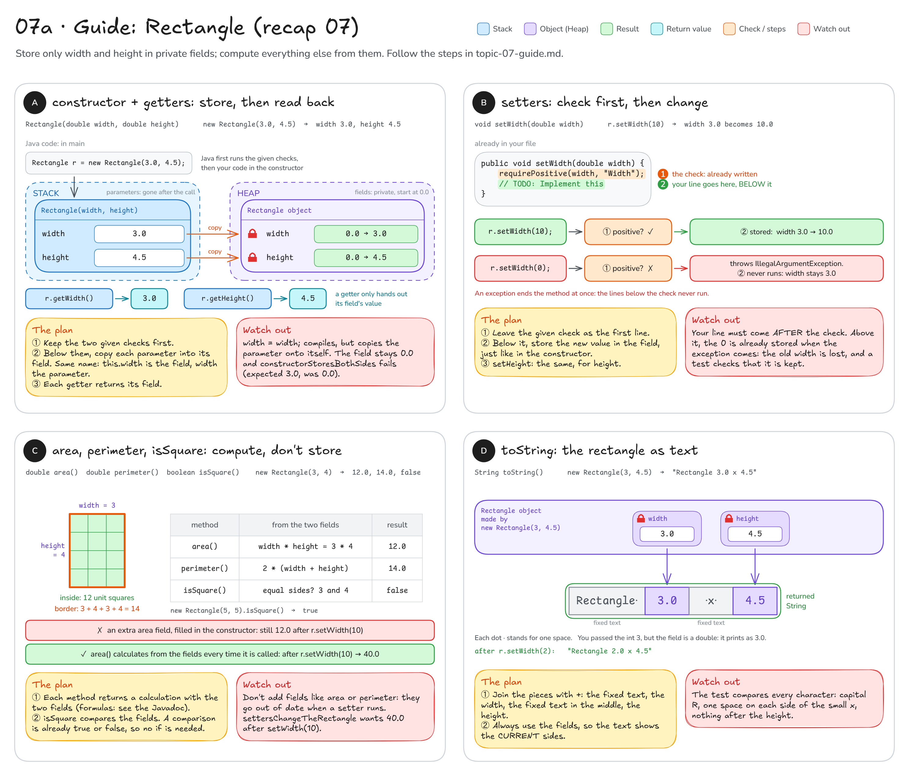
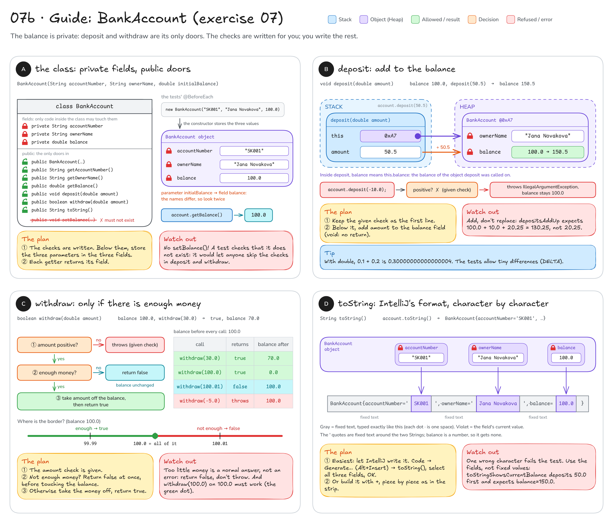

# Topic 7 · Classes and encapsulation: step-by-step guide

This guide walks you through **recap 07 (`Rectangle`)** and **exercise 07 (`BankAccount`)**.
It gives you pictures, steps and hints, **not finished code**: you still write every method yourself.

**How to use it:** do one method at a time. Look at its picture, follow the steps, write the code,
then run that method's tests. Only when they are green, move on.

## Before you start: four facts

1. A class is a **blueprint**. `new` builds an **object** from it on the Heap, and every object gets its own
   copy of the fields. A field lives as long as its object; a parameter lives only while its method runs.
2. **`private`** fields can only be read or changed by code inside the class. Everyone else has to go through the
   public methods (constructor, getters, setters, ...), and those methods can refuse bad values.
   That is **encapsulation**. In both exercises a test checks that every field stays `private`.
3. When a parameter has the **same name** as a field, the plain name means the **parameter**.
   Write `this.` in front of it to mean the field of this object: `this.width` is the field, `width` the parameter.
   (See [diagram 07](README.md#07--classes-objects--encapsulation) for the picture.)
4. In both classes the input checks are **already written** at the top of the methods. Keep them,
   and put your own lines **below** them.

---

## Part 1 · Recap 07: `Rectangle`

You write: `src/main/java/sk/upjs/paz1a/tutoring/recap/exercise07/Rectangle.java`. Tests: `RectangleTest`.
The two fields `width` and `height` and the size checks (`requirePositive`) are already there; you fill in the TODOs.



### A · constructor + getters: store, then read back

**Goal:** after `new Rectangle(3.0, 4.5)`, `getWidth()` returns `3.0` and `getHeight()` returns `4.5`.

1. Leave the two `requirePositive(...)` lines first. They throw for a zero or negative side, so a bad
   rectangle is never built.
2. Below them, copy the parameter `width` into the field `width`, and the parameter `height` into the field `height`.
   They have the same names, so the field needs `this.` in front.
3. `getWidth()` returns the field `width`, `getHeight()` returns the field `height`.

Fill in the blanks (the constructor):

```java
requirePositive(width, "Width");     // given
requirePositive(height, "Height");   // given
this.___ = ___;
this.___ = ___;
```

**Check:** `constructorStoresBothSides`, `constructorRejectsZeroOrNegativeSides`.

**Common mistakes**
- `width = width;` without `this.`: it compiles, but copies the parameter onto itself. The field keeps its
  starting value `0.0`, and the test says *expected 3.0 but was 0.0*.
- Copy-paste slip: `getHeight()` still returns `width`.

### B · setters: check first, then change

**Goal:** `r.setWidth(10)` changes the width from `3.0` to `10.0`. `r.setWidth(0)` throws an
`IllegalArgumentException`, and the width stays `3.0`.

1. The first line, `requirePositive(width, "Width");`, is given. For a bad value it throws, and an exception
   ends the method at once: nothing below it runs.
2. Below the check, store the new value in the field, the same way as in the constructor.
3. `setHeight` is the same, for `height`.

**Check:** `settersChangeTheRectangle`, `settersRejectInvalidValuesAndKeepTheOldOnes`.

**Common mistakes**
- Storing the value **above** the check: the exception still comes, but the bad value is already in the field,
  so the old width is lost.
- Removing the check because "the constructor already checks": a setter is a second way in and needs its own guard.

### C · area, perimeter, isSquare: compute, don't store

**Goal:** for `new Rectangle(3, 4)`: `area()` → `12.0`, `perimeter()` → `14.0`, `isSquare()` → `false`.
`new Rectangle(5, 5).isSquare()` → `true`.

1. `area()`: the Javadoc gives the formula, width times height. Return it.
2. `perimeter()`: the Javadoc formula is `2 * (width + height)`. Check it on the picture: walking around the
   3 × 4 border gives 3 + 4 + 3 + 4 = 14.
3. `isSquare()`: are the two fields equal? A comparison is already a `boolean` (`true` or `false`),
   so you can return it without an `if`.
4. Use only the two fields. Do **not** add `area` or `perimeter` fields.

**Check:** `areaIsWidthTimesHeight`, `perimeterIsTheLengthOfTheBorder`, `unitSquare`, `equalSidesMakeASquare`,
`differentSidesAreNotASquare`, `settersChangeTheRectangle`.

**Common mistakes**
- An `area` field filled in the constructor: right at first, but after `setWidth(10)` it still says `12.0`
  instead of `40.0`. Calculating every time keeps the answer up to date.
- `2 * width + height` without parentheses: only the width is doubled (2 · 3 + 4 = 10, not 14).
- `=` instead of `==`: `=` stores a value, `==` compares two values.

### D · toString: the rectangle as text

**Goal:** `new Rectangle(3, 4.5).toString()` → `"Rectangle 3.0 x 4.5"`. After `setWidth(2)` → `"Rectangle 2.0 x 4.5"`.

1. Cut the text into pieces, as in the picture: the fixed text `Rectangle ` (with a space at the end),
   the width, the fixed text ` x ` (a space on both sides), the height.
2. Join the pieces with `+`. Adding a `double` to a `String` turns the number into text, and a `double`
   always shows its decimal part: the `3` you passed in prints as `3.0`.
3. Return the result. Take the numbers from the fields, never type them in.

**Check:** `toStringShowsBothSides`, `toStringShowsTheCurrentSides`.

**Common mistakes**
- A missing or extra space (`"Rectangle3.0 x 4.5"`, `"Rectangle 3.0 x 4.5 "`), or a capital `X`:
  the test compares every character.
- Returning the fixed text `"Rectangle 3.0 x 4.5"`: the first test passes, the second one fails.

**At the end:** run the whole `RectangleTest`. `allInstanceFieldsArePrivate` checks that your fields are still `private`.

---

## Part 2 · Exercise 07: `BankAccount`

You write: `src/main/java/sk/upjs/paz1a/tutoring/exercise07/BankAccount.java`. Tests: `BankAccountTest`.
The three private fields and all input checks are already written. Every test starts with the account built in
`@BeforeEach`: `new BankAccount("SK001", "Jana Novakova", 100.0)`.



### A · constructor + getters: the starting state

**Goal:** after `new BankAccount("SK001", "Jana Novakova", 100.0)` the getters return `"SK001"`,
`"Jana Novakova"` and `100.0`.

1. Leave the checks at the top: they reject a missing account number or owner name and a negative start balance.
2. Below them, store the three parameters in the three fields. Look at the names closely:
   the parameter `initialBalance` goes into the field `balance`.
3. Write the three getters. Each one returns its field.
4. Do **not** add a `setBalance` method. The balance may only change through `deposit` and `withdraw`.

**Check:** `constructorStoresAllValues`, `accountCanStartWithZeroBalance`, `constructorRejectsNegativeBalance`,
`constructorRejectsMissingAccountNumber`, `constructorRejectsMissingOwnerName`, `thereIsNoSetterForBalance`.

**Common mistakes**
- `this.balance = balance;`: there is no parameter called `balance`, so this copies the field onto itself
  and the balance stays `0.0`.
- A public `setBalance(...)` "to make it easier": anyone could then skip the checks in `deposit` and `withdraw`,
  and `thereIsNoSetterForBalance` fails.

### B · deposit: add to the balance

**Goal:** balance `100.0`, `deposit(50.5)` → balance `150.5`. `deposit(-10.0)` or `deposit(0.0)` →
`IllegalArgumentException`, and the balance stays `100.0`.

1. The check `requirePositive(amount);` is the first line, and it is given.
2. Below it, make the balance bigger by `amount`: the new balance is the old balance plus the amount.
3. The method is `void`, so there is nothing to return.

Trace `depositsAddUp` on paper:

| step | balance |
|------|---------|
| start | 100.0 |
| `deposit(10.0)` | 110.0 |
| `deposit(20.25)` | 130.25 |

**Check:** `depositIncreasesBalance`, `depositsAddUp`, `depositOfSmallDecimalAmounts`,
`depositRejectsNegativeAmountAndKeepsBalance`, `depositRejectsZero`.

**Common mistakes**
- Replacing instead of adding: after the two deposits the balance is `20.25` instead of `130.25`.
- Changing the balance above the check: the exception still comes, but the money has already changed.
- Worrying about `0.30000000000000004`: that is how `double` works. The tests allow a tiny difference (`DELTA`).

### C · withdraw: only if there is enough money

**Goal** (balance `100.0` before every call):

| call | returns | balance after |
|------|---------|---------------|
| `withdraw(30.0)` | `true` | 70.0 |
| `withdraw(100.0)` | `true` | 0.0 |
| `withdraw(100.01)` | `false` | 100.0 |
| `withdraw(-5.0)` | throws `IllegalArgumentException` | 100.0 |

1. The amount check is the first line, and it is given.
2. Is the amount **more** than the balance? Then there is not enough money: return `false` straight away,
   without touching the balance.
3. Otherwise, take the amount off the balance and return `true`.

Before you write the condition, decide on paper: with a balance of 100.0, which of 99.99, 100.0 and 100.01 may
be withdrawn? (Look at the number line in the picture.)

**Check:** `withdrawWithEnoughMoneySucceeds`, `withdrawWholeBalanceSucceeds`,
`withdrawMoreThanBalanceFailsAndKeepsBalance`, `withdrawRejectsNegativeAmountAndKeepsBalance`, `withdrawRejectsZero`.

**Common mistakes**
- Throwing an exception when the money is not enough. Read the Javadoc: too little money is a normal answer
  (`false`); only a zero or negative amount is an error.
- The wrong comparison on the border: `withdrawWholeBalanceSucceeds` fails because taking exactly 100.0 was refused.
- Subtracting first and checking afterwards: when you then return `false`, the balance has already changed.

### D · toString: IntelliJ's format

**Goal:** exactly `BankAccount{accountNumber='SK001', ownerName='Jana Novakova', balance=100.0}`.

This is the format IntelliJ generates. The pattern behind it:

```text
ClassName{textField='value', otherTextField='value', numberField=value}
```

`String` fields get single quotes `'...'`, numbers get none, and a comma plus one space separates the fields.

1. Easiest way: let IntelliJ write it. Put the cursor inside the class, then **Code → Generate… → toString()**
   (`Alt+Insert` on Windows/Linux, `Cmd+N` on macOS), select all three fields, OK.
   If IntelliJ asks whether to replace the existing `toString()`, say yes (or delete the TODO version first).
2. Or build it yourself with `+`, piece by piece as in the picture: the gray pieces are fixed text,
   the violet ones come from the fields.
3. Run the two tests and compare.

**Check:** `toStringShowsAllFields`, `toStringShowsCurrentBalance`.

**Common mistakes**
- Quotes around the balance (`balance='100.0'`), or no quotes around the two Strings.
- A missing space after a comma, or a missing `{` / `}`.
- Typing the values (`'SK001'`, `100.0`) instead of using the fields: `toStringShowsCurrentBalance` deposits
  `50.0` first and expects `balance=150.0`.

**Tip:** when an `assertEquals` on two Strings fails, IntelliJ shows a **Click to see difference** link in the test
output. It marks exactly the characters that differ.

**At the end:** run the whole `BankAccountTest`. `allInstanceFieldsArePrivate` and `thereIsNoSetterForBalance`
check your encapsulation.

---

**Still stuck?** Draw the object as a box with its fields, like in the pictures. Then go through the failing test
line by line and write down every field's value after every call. Compare with what the test expects.
