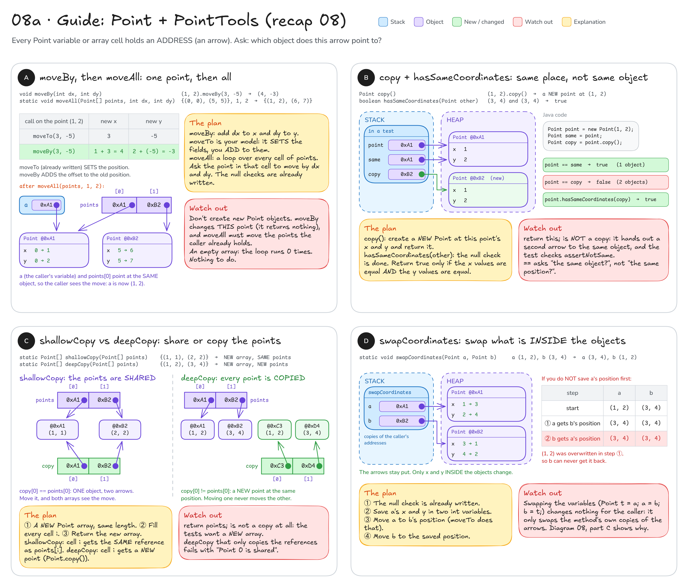
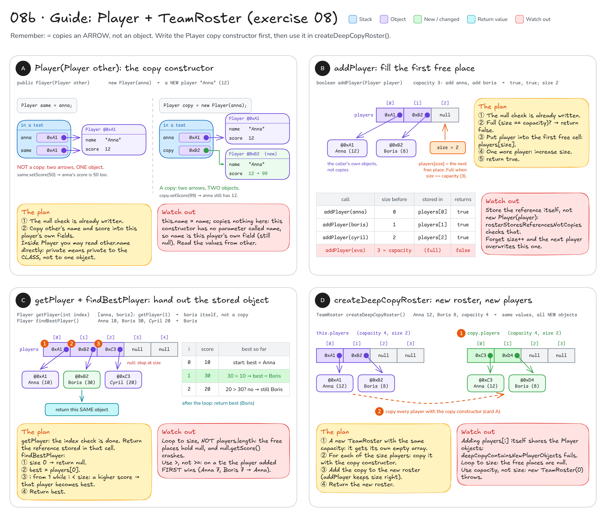

# Topic 8 · References & pass-by-value: step-by-step guide

This guide walks you through **recap 08 (`Point`, `PointTools`)** and **exercise 08 (`Player`, `TeamRoster`)**.
It gives you pictures, steps and hints, **not finished code**: you still write every method yourself.

**How to use it:** do one method at a time. Look at its picture, follow the steps, write the code,
then run that method's tests. Only when they are green, move on.

## Before you start: four facts

1. A variable of a class type (`Point`, `Player`) does **not** hold the object. It holds the object's **address**.
   Draw it as an arrow. `new` builds a new object; `=` only copies the **arrow**.
2. Java passes a **copy** of every argument. For an object, that is a copy of the arrow: the method can change the
   object through it, but pointing the parameter at another object changes nothing for the caller.
   (See [diagram 08](README.md#08--pass-by-value--references) for the picture.)
3. `a == b` on two objects asks **"is it the same object?"** (the same address), not "do they look the same?".
4. An array of objects (`Point[]`, `Player[]`) is an **array of arrows**. Copying the cells copies arrows, not objects.

```java
Point a = new Point(1, 2);   // new: ONE object, a holds its address
Point b = a;                 // copies the ARROW: still one object
b.moveTo(5, 5);              // changes that one object...
System.out.println(a);       // (5, 5)  ...so a sees the change too
```

---

## Part 1 · Recap 08: `Point` and `PointTools`

You write: `src/main/java/sk/upjs/paz1a/tutoring/recap/exercise08/Point.java` and `PointTools.java`.
Tests: `PointToolsTest`. Read its first test, `javaPassesACopyOfTheReference`, before anything else: it already passes
and shows facts 1 and 2 in action. All the `null` checks are already written for you.



### A · `moveBy`, then `moveAll`: one point, then all

**Goal (`moveBy`):** the point `(1, 2)` after `moveBy(3, -5)` is at `(4, -3)`.

1. Look at `moveTo` right above it (already written). It **sets** `x` and `y` to the new values.
2. `moveBy` is almost the same, but the new `x` is the **old** `x` plus `dx` (and the same for `y`).
3. The method returns nothing (`void`): change the fields of **this** point, don't create a new one.

Fill in the blanks:

```java
public void moveBy(int dx, int dy) {
    this.x = ___;
    this.y = ___;
}
```

**Check:** `moveByChangesBothCoordinates`.

**Goal (`moveAll`):** points `{(0, 0), (5, 5)}`, `dx = 1`, `dy = 2` → the points are now at `(1, 2)` and `(6, 7)`,
and the caller's own variable `a` sees it.

1. Loop over every index `i` of `points`.
2. `points[i]` is a `Point`: ask it to move by `dx` and `dy`. You just wrote the method for that.
3. Nothing to return.

Why does the caller see the change? `points[0]` and the caller's `a` hold the **same address**, so there is only
one object to move (the picture shows both arrows).

**Check:** `moveAllMovesThePointsTheCallerHolds`, `moveAllOnEmptyArrayDoesNothing`, `moveAllRejectsNullArrayOrNullPoint`.

**Common mistakes**
- `this.x = dx;` in `moveBy`: that is `moveTo` again. The test then gets `x = 3` instead of `4`.
- Putting **new** points into the array in `moveAll`: the caller's `a` still points at the old object, which never moved.

### B · `copy` and `hasSameCoordinates`: same place, not same object

**Goal (`copy`):** `(1, 2).copy()` → a **new** point at `(1, 2)`. Moving the copy must not move the original.

1. Build a new `Point` with this point's `x` and `y` (the constructor takes exactly those two numbers).
2. Return it.

**Check:** `copyIsANewPointAtTheSamePosition`, `movingTheCopyDoesNotMoveTheOriginal`.

**Goal (`hasSameCoordinates`):** `new Point(3, 4)` and another `new Point(3, 4)` → `true`, even though `a == b` is `false`.
`(3, 4)` and `(4, 3)` → `false`.

1. The `null` check is already written.
2. Compare this point's `x` with `other`'s `x`, and this point's `y` with `other`'s `y`.
   (Inside `Point` you may read `other.x` directly, or call `other.getX()`.)
3. Return `true` only if **both** pairs are equal.

**Check:** `samePositionIsNotTheSameObject`, `differentPositions`, `hasSameCoordinatesRejectsNull`.

**Common mistakes**
- `return this;` in `copy()`: that hands out a second arrow to the **same** object, so `assertNotSame` fails.
- `return this == other;`: compares addresses, so two different objects at the same place give `false`.
- `||` instead of `&&`: then `(3, 4)` and `(3, 9)` would count as the same place.

### C · `shallowCopy` vs `deepCopy`: share or copy the points

**Goal:** both return a **new** array of the same length.
- `shallowCopy`: the new cells point at the **same** `Point` objects (`copy[0] == points[0]`).
- `deepCopy`: the new cells point at **new** `Point` objects at the same positions (`copy[0] != points[0]`).

1. Create a new `Point` array with as many cells as `points` has.
2. Loop over every index `i` and fill `copy[i]`:
   - `shallowCopy`: the same reference that `points[i]` holds.
   - `deepCopy`: a new point at the same position. `copy()` from part B makes exactly that.
3. Return the new array.

`shallowCopyArrayItselfIsIndependent` puts a new point into `copy[0]`. That only changes the copy's cell: the two
**arrays** are separate even when they share the points.

**Check:** `shallowCopyIsANewArrayWithTheSamePoints`, `shallowCopySharesThePoints`, `shallowCopyArrayItselfIsIndependent`,
`shallowCopyRejectsNull`, `deepCopyHasNewPointsAtTheSamePositions`, `movingAnOriginalPointDoesNotMoveItsDeepCopy`,
`deepCopyRejectsNullArrayOrNullPoint`.

**Common mistakes**
- `return points;` (or `Point[] copy = points;`): no new array at all, only a second arrow to the old one.
- Forgetting `copy()` in `deepCopy`: the test says *"Point 0 is shared - copy every point"*.

### D · `swapCoordinates`: swap what is inside the objects

**Goal:** `a` at `(1, 2)`, `b` at `(3, 4)` → afterwards `a` is at `(3, 4)` and `b` is at `(1, 2)`.
The caller's `a` and `b` still point at the **same two objects**; only their `x` and `y` change.

1. The `null` check is already written.
2. **Before** changing anything, save `a`'s `x` and `y` in two local `int` variables.
3. Move `a` to `b`'s position (`moveTo` does that).
4. Move `b` to the position you saved in step 2.

What happens if you skip step 2:

| step | a | b |
|------|---|---|
| start | (1, 2) | (3, 4) |
| a gets b's position | (3, 4) | (3, 4) |
| b gets a's position | (3, 4) | (3, 4) ✗ the (1, 2) is already gone |

**Check:** `swapCoordinatesSwapsThePositions`, `swapCoordinatesRejectsNull`.

**Common mistakes**
- Swapping the parameters (`Point t = a; a = b; b = t;`): it compiles, but it only swaps the method's own
  copies of the arrows. The caller sees nothing (part C of diagram 08).
- Forgetting step 2: both points end up at `(3, 4)`.

---

## Part 2 · Exercise 08: `Player` and `TeamRoster`

You write: the copy constructor in `src/main/java/sk/upjs/paz1a/tutoring/exercise08/Player.java`, then the methods
in `TeamRoster.java`. Tests: `TeamRosterTest`. Read its first test, `assignmentCopiesTheReferenceNotTheObject`:
it already passes. The constructor, `getCapacity()` and `getSize()` are done (so `newRosterIsEmpty` is already green).
This time you get steps only, no code skeletons.



**How the roster stores players:** `players` is an array with `capacity` cells, but only the first `size` cells hold
players. The rest are `null`. Every cell holds an **arrow** to a `Player`, never a player itself.

### A · `Player(Player other)`: the copy constructor

Do this one first: part D needs it.

**Goal:** `new Player(anna)` → a **new** player `"Anna"` with score `12`. Then `copy.setScore(99)` must leave `anna` at `12`.

1. The `null` check is already written.
2. A constructor fills the object that is being built (`this`). Copy `other`'s name into this player's `name` field.
3. Do the same for the score.

Two things that may surprise you:
- You may read `other.name` and `other.score` directly: `private` means private to the **class**, not to one object.
- Sharing the `name` String is safe, because a String can never change. `score` is an `int`, so the number itself is copied.

**Check:** `copyConstructorCreatesAnIndependentPlayer`, `copyConstructorRejectsNull`.

**Common mistakes**
- `this.name = name;` copied from the other constructor: this constructor has **no** parameter called `name`, so
  `name` means the field itself. The copy ends up with `null` and `0`.
- `Player same = anna;` somewhere in a test of your own: that is not a copy, only a second arrow (the left half of the picture).

### B · `addPlayer`: fill the first free place

**Goal:** capacity 3, add `anna`, add `boris` → both calls return `true`, `getSize()` is `2`, and `getPlayer(0)` is
`anna` **itself**. Adding to a full roster returns `false` and changes nothing.

1. The `null` check is already written.
2. Is the roster full? (When is that? Compare `size` with `capacity`.) Then return `false`.
3. The first free cell is the one with index `size`. Put the player there: the reference itself, not a copy.
4. There is one more player now: update `size`.
5. Return `true`.

| call | size before | stored in | returns |
|------|-------------|-----------|---------|
| `addPlayer(anna)` | 0 | `players[0]` | `true` |
| `addPlayer(boris)` | 1 | `players[1]` | `true` |
| `addPlayer(cyril)` | 2 | `players[2]` | `true` |
| `addPlayer(eva)` | 3 = capacity | nothing | `false` |

**Check:** `addPlayerStoresPlayersInOrder`, `addPlayerReturnsFalseWhenRosterIsFull`, `addPlayerRejectsNull`,
`rosterStoresReferencesNotCopies` (this one also needs `getPlayer`, so do part C's `getPlayer` together with this).

**Common mistakes**
- Storing `new Player(player)`: `rosterStoresReferencesNotCopies` fails, because the roster no longer sees changes
  made to `anna` from outside.
- Forgetting to update `size`: every new player overwrites `players[0]`.
- Checking `size > capacity` instead of the right condition: on a full roster you then write one cell past the end
  (`ArrayIndexOutOfBoundsException`).

### C · `getPlayer` and `findBestPlayer`: hand out the stored object

**Goal (`getPlayer`):** `getPlayer(1)` on a roster with `anna, boris` → `boris` **itself** (the test uses `assertSame`).

1. The index check is already written.
2. Return the reference stored in that cell. No copy.

**Check:** `getPlayerRejectsInvalidIndex` (plus the `addPlayer…` tests above).

**Goal (`findBestPlayer`):** `Anna 10, Boris 30, Cyril 20` → `Boris`, the stored object. Empty roster → `null`.
On a tie, the player added **first** wins.

1. Empty roster (`size` is 0)? Return `null`.
2. Start with `best` = the first player.
3. Go through the other players, `i` from 1 while `i < size`. If a player's score is **higher** than `best`'s score,
   that player becomes the new `best`.
4. After the loop, return `best`.

| i | score | best so far |
|---|-------|-------------|
| 0 | 10 | start: Anna |
| 1 | 30 | 30 > 10, so **Boris** |
| 2 | 20 | 20 > 30? no, still Boris |

**Check:** `findBestPlayerReturnsHighestScore`, `findBestPlayerWhenBestIsLast`, `findBestPlayerWithNegativeScores`,
`findBestPlayerPrefersFirstAddedOnTie`, `findBestPlayerIgnoresEmptyPlaces`, `emptyRosterHasNoBestPlayer`.

**Common mistakes**
- Looping to `players.length`: the free places are `null`, and asking `null` for its score throws a
  `NullPointerException` (`findBestPlayerIgnoresEmptyPlaces` has 9 empty places).
- `>=` instead of `>`: on a tie the later player wins, but the first one should.
- Remembering only the best **score** in an `int` that starts at `0`: you must return the `Player`, and with
  negative scores nobody ever beats 0.

### D · `createDeepCopyRoster`: new roster, new players

**Goal:** a roster with capacity 4 holding `Anna 12, Boris 8` → a **new** roster with capacity 4, size 2,
`Anna 12, Boris 8`, where the array **and** every `Player` are new objects. Changing a player (or adding one) on
either side must not affect the other.

1. Create a new `TeamRoster` with the **same capacity**. Its constructor gives it its own empty array.
2. Go through the first `size` players of **this** roster.
3. Copy each one with the copy constructor from part A.
4. Add the copy to the new roster. `addPlayer` already puts it in the right place and counts `size` for you.
5. Return the new roster.

**Check:** `deepCopyHasSameCapacitySizeAndValues`, `deepCopyContainsNewPlayerObjects`,
`changingOriginalPlayerDoesNotChangeTheCopy`, `changingCopiedPlayerDoesNotChangeTheOriginal`,
`copyAndOriginalHaveSeparateArrays`, `deepCopyOfEmptyRoster`.

**Common mistakes**
- `return this;`: not a copy at all, `assertNotSame(roster, copy)` fails.
- Adding `players[i]` itself: both rosters share the players, and the test says
  *"Player 0 is shared by both rosters - use the Player copy constructor"*.
- `new TeamRoster(size)`: the capacity is wrong, and for an empty roster `new TeamRoster(0)` throws.
- Looping to `capacity`: the free places are `null`, and copying `null` throws.

---

**Still stuck?** Draw it on paper: one box per object, one arrow per variable or array cell. Then run your code one
line at a time on the drawing and ask: does this line move an **arrow** (`=`) or change what is **inside a box**
(a setter, `moveTo`, a field assignment)?
