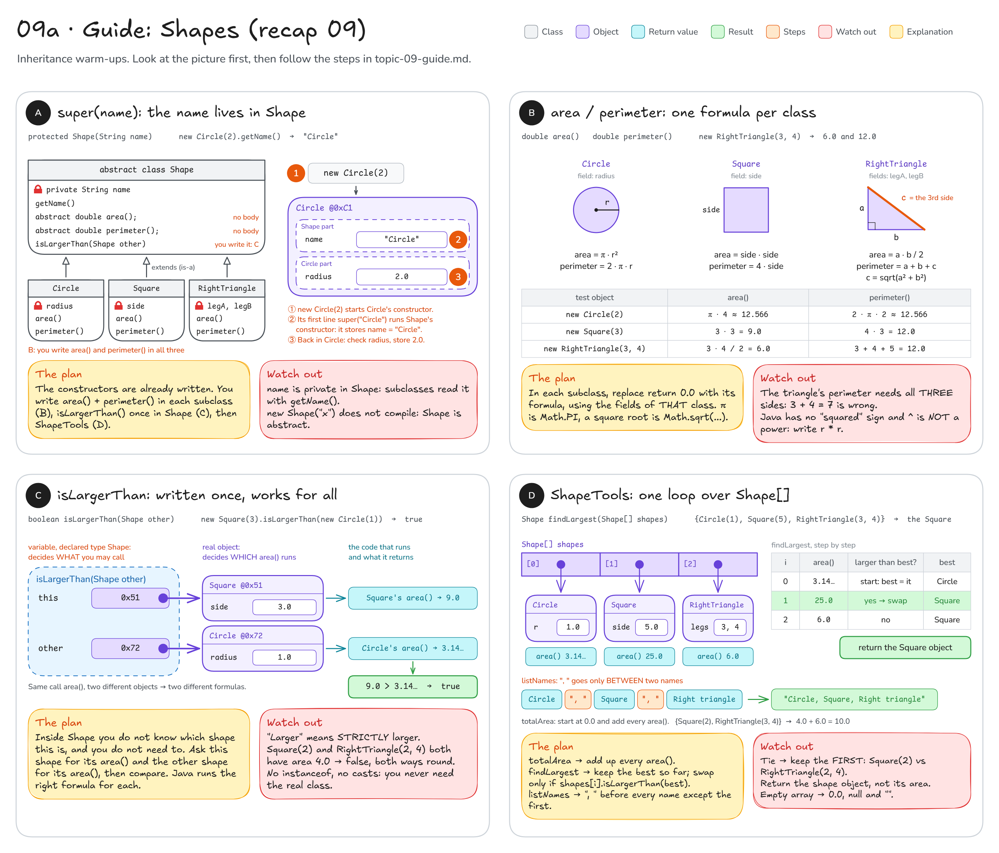
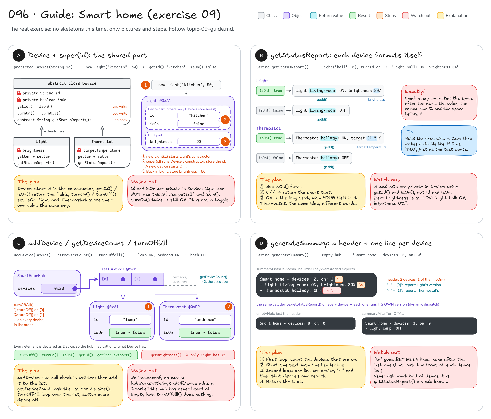

# Topic 9 · Inheritance & dynamic dispatch: step-by-step guide

This guide walks you through **recap 09 (the shapes)** and **exercise 09 (the smart home)**.
It gives you pictures, steps and hints, **not finished code**: you still write every method yourself.

**How to use it:** do one method at a time. Look at its picture, follow the steps, write the code,
then run that method's tests. Only when they are green, move on.

## Before you start: four facts

1. `class Dog extends Animal` means a `Dog` **is an** `Animal`. It gets every public method of `Animal` for free
   and adds its own fields and methods.
2. An `abstract` class cannot be created with `new`. An `abstract` method has **no body**: every normal subclass
   must write it (with `@Override`), or the code does not compile.
3. The first line of a subclass constructor is `super(...)`. It runs the parent's constructor, which fills in the
   parent's part of the object. The parent's `private` fields stay invisible to the subclass: use the parent's
   public getters instead.
4. **The declared type decides WHAT you may call. The real object decides WHICH code runs.**
   (See [diagram 09](README.md#09--inheritance--dynamic-dispatch) for the picture.)

```java
Animal a = new Dog("Rex");   // declared type Animal, real object Dog
a.speak();                   // compiles, because Animal has speak()
                             // runs Dog's speak(), because the object is a Dog
```

---

## Part 1 · Recap 09: the shapes

You write: `Circle.java`, `Square.java`, `RightTriangle.java`, `Shape.java` and `ShapeTools.java` in
`src/main/java/sk/upjs/paz1a/tutoring/recap/exercise09/`. Tests: `ShapesTest`.
The constructors and the `null` checks are already written for you.



### A · `super(name)`: the name lives in Shape

Nothing to write here yet, but read it once, because exercise 09 uses the same idea.

1. Open `Circle.java`. The first line of its constructor is `super("Circle")`.
2. That line runs `Shape`'s constructor, which stores `"Circle"` in Shape's **private** `name` field.
3. Back in `Circle`'s constructor, the radius is checked and stored in Circle's own field.
4. So one `Circle` object has two parts: a Shape part (`name`) and a Circle part (`radius`).

Ask yourself: why could `Circle` not simply write `this.name = "Circle"`? (Answer: `name` is private in `Shape`.)

**Check:** `circleRejectsZeroOrNegativeRadius`, `squareRejectsZeroOrNegativeSide` and
`rightTriangleRejectsZeroOrNegativeLegs` are already green, because the constructors are written for you.

**Common mistakes**
- Adding a second `name` field to a subclass: the name already lives in `Shape`, read it with `getName()`.
- `new Shape("x")`: does not compile, `Shape` is abstract.

### B · `area` / `perimeter`: one formula per class

**Goal:** `new Circle(2)` → area `π · 4 ≈ 12.566`, perimeter also `≈ 12.566`.
`new Square(3)` → `9.0` and `12.0`. `new RightTriangle(3, 4)` → `6.0` and `12.0`.

1. Start with `Circle`. Which field does it have? (`radius`.)
2. `area()`: π · r². In Java π is `Math.PI`, and r² is simply `r * r`.
3. `perimeter()`: 2 · π · r.
4. `Square`: the same idea with `side` (area = side · side, perimeter = 4 · side).
5. `RightTriangle`: area = a · b / 2. For the perimeter you need the **third side** first:
   hypotenuse = sqrt(a² + b²), in Java `Math.sqrt(...)`. A local variable `double hypotenuse = ...` keeps it readable.
   Then add up all three sides.

Fill in the blank for your first method:

```java
@Override
public double area() {
    return ___;   // π · r², using Math.PI and the field radius
}
```

**Check:** `circleArea`, `circlePerimeter`, `squareAreaAndPerimeter`, `rightTriangleArea`,
`rightTrianglePerimeterIncludesTheHypotenuse`, `eachShapeComputesItsOwnArea`.

**Common mistakes**
- `radius ^ 2`: in Java `^` is **not** a power (it is a bit operation, and with a `double` it does not even
  compile). Write `radius * radius`.
- The triangle's perimeter without the hypotenuse: `3 + 4 = 7.0` instead of `12.0`.
- `1 / 2 * legA * legB`: `1 / 2` is integer division, which is `0`. Write the `/ 2` at the end.

### C · `isLargerThan`: written once, works for all

**Goal:** `true` if **this** shape's area is strictly larger than the **other** shape's area.

| call (from the tests) | area of this | area of other | result |
|------|-----|-----|-----|
| `Square(3)` vs `Circle(1)` | 9.0 | 3.14… | `true` |
| `Circle(1)` vs `Square(3)` | 3.14… | 9.0 | `false` |
| `Square(2)` vs `RightTriangle(2, 4)` | 4.0 | 4.0 | `false` (equal is not larger) |

1. The `null` check is already there.
2. Get this shape's area: call `area()` on this object.
3. Get the other shape's area: call `area()` on `other`.
4. Return whether the first one is **strictly** bigger.

Why does this work, when `area()` in `Shape` has no body? The declared type is `Shape`, and `Shape` has an
`area()` method, so the call compiles. When it runs, Java looks at the real object: for a `Square` it runs
Square's `area()`, for a `Circle` it runs Circle's. The picture shows both calls side by side.

**Check:** `largerAreaIsLarger`, `equalAreasAreNotLarger`, `isLargerThanRejectsNull`.

**Common mistakes**
- `>=` instead of `>`: `equalAreasAreNotLarger` fails.
- Writing `isLargerThan` again in every subclass, or using `instanceof` and casts to find out the shape:
  not needed, `Shape`'s one version already works for every shape.

### D · `ShapeTools`: one loop over `Shape[]`

All three methods walk through the array once. `requireNoNulls` at the bottom of the file already loops over
`shapes`: copy its loop header. Inside the loop, `shapes[i]` is declared as a `Shape`, so you may call
`area()`, `getName()` and `isLargerThan(...)` on it, and each object answers with its own code.

**`totalArea`.** **Goal:** `{Square(2), RightTriangle(3, 4)}` → `4.0 + 6.0 = 10.0`. Empty array → `0.0`.

1. A running total that starts at `0.0`.
2. For every shape, add its `area()`.
3. Return the total.

**Check:** `totalAreaAddsUpAllShapes`, `totalAreaOfEmptyArrayIsZero`.

**`findLargest`.** **Goal:** `{Circle(1), Square(5), RightTriangle(3, 4)}` → **the** `Square` object (the test checks
with `assertSame`, so return the shape itself, not its area). On a tie, the first one wins. Empty array → `null`.

1. Empty array → return `null` right away.
2. `best` = the shape at index 0.
3. For every **other** shape: if it is larger than `best` (use `isLargerThan`), it becomes the new `best`.
4. Return `best`.

| i | area() | larger than best? | best |
|---|--------|-------------------|------|
| 0 | 3.14… | start: best = it | Circle |
| 1 | 25.0 | yes | Square |
| 2 | 6.0 | no | Square |

**Check:** `findLargestReturnsTheShapeWithTheLargestArea`, `findLargestPrefersTheFirstOnATie`,
`findLargestOfEmptyArrayIsNull`.

**`listNames`.** **Goal:** `{Circle(1), Square(2), RightTriangle(3, 4)}` → `"Circle, Square, Right triangle"`.
Empty array → `""`.

1. Start with an empty `String`.
2. For every shape: if it is **not the first one**, add `", "` first. Then add its `getName()`.
3. Return the text.

**Check:** `listNamesInOrder`, `listNamesOfEmptyArrayIsEmpty`, and for all three methods
`toolsRejectNullArrayOrNullShape` and `toolsWorkWithAnyKindOfShape` (a "Blob" shape that `ShapeTools` has never heard of).

**Common mistakes**
- `listNames` with `", "` after every name: you get `"Circle, Square, Right triangle, "`.
- `findLargest` comparing with "larger or equal": on the tie test you return the second shape instead of the first.
- `findLargest` returning `shapes[i].area()` (a `double`) instead of the shape: does not even compile.

---

## Part 2 · Exercise 09: the smart home

You write: `Device.java`, `Light.java`, `Thermostat.java` and `SmartHomeHub.java` in
`src/main/java/sk/upjs/paz1a/tutoring/exercise09/`. Tests: `SmartHomeTest`.
The input checks (`id`, brightness, temperature, `null` device) are already written; this time you only get steps.



### A · `Device` + `super(id)`: the shared part

**Goal:** `new Light("kitchen", 50)` → `getId()` is `"kitchen"`, `isOn()` is `false`.
After `turnOn()` it is on; after `turnOn()` twice it is **still** on; after `turnOff()` it is off.

1. `Device`'s constructor: after the given check, store the id in the field. A new device is **off**.
2. `getId()` and `isOn()` return their fields.
3. `turnOn()` switches the device on, `turnOff()` switches it off. Neither of them "flips" the state.
4. `Light`: `super(id)` and the brightness check are already in the constructor; store the brightness.
   `getBrightness()` returns it. In `setBrightness`, the check is the first line, so just store the value after it:
   an invalid value throws **before** anything is stored, and the old value stays.
5. `Thermostat`: exactly the same with `targetTemperature`.

**Check:** `newDeviceIsOffAndKeepsItsId`, `deviceCanBeTurnedOnAndOff`, `turningOnTwiceKeepsDeviceOn`,
`deviceRejectsNullOrBlankId`, then for `Light`: `lightStoresBrightness`, `lightAcceptsBrightnessLimits`,
`lightRejectsBrightnessOutOfRange`, `setBrightnessChangesBrightness`, `setBrightnessRejectsInvalidValueAndKeepsOldOne`,
and for `Thermostat`: `thermostatStoresTargetTemperature`, `thermostatAcceptsTemperatureLimits`,
`thermostatRejectsTemperatureOutOfRange`, `setTargetTemperatureChangesTemperature`,
`setTargetTemperatureRejectsInvalidValueAndKeepsOldOne`.

**Common mistakes**
- `turnOn()` that flips the state: `turningOnTwiceKeepsDeviceOn` fails.
- `brightness = brightness;` in the constructor: the parameter has the same name as the field, so this changes
  nothing. Use `this.brightness`.
- `this.id` inside `Light`: compile error, `id` has private access in `Device`.

### B · `getStatusReport`: each device formats itself

**Goal:** these exact strings (from the tests):

| device | state | `getStatusReport()` |
|--------|-------|---------------------|
| `Light("living-room", 80)` | on | `Light living-room: ON, brightness 80%` |
| `Light("living-room", 80)` | off | `Light living-room: OFF` |
| `Light("hall", 0)` | on | `Light hall: ON, brightness 0%` |
| `Thermostat("hallway", 21.5)` | on | `Thermostat hallway: ON, target 21.5 C` |
| `Thermostat("hallway", 21.5)` | off | `Thermostat hallway: OFF` |
| `Thermostat("bedroom", 19.0)` | on | `Thermostat bedroom: ON, target 19.0 C` |

1. Ask `isOn()` first.
2. Off → the short text: the word `Light`, a space, the id, then `: OFF`.
3. On → the long text, which also contains your own field (`brightness` or `targetTemperature`).
4. The id comes from `getId()`, because the field is private in `Device`.
5. Build the text with `+`. Java then writes the `double` 19.0 as `19.0`, exactly as the test wants.

**Check:** `lightStatusReportWhenOn`, `lightStatusReportWhenOff`, `lightStatusReportAtZeroBrightness`,
`thermostatStatusReportWhenOn`, `thermostatStatusReportWhenOff`, `sameMethodCallGivesDeviceSpecificReports`.

**Common mistakes**
- A missing space, colon or `%`. When a test fails, click "Click to see difference" in IntelliJ and compare
  the two strings character by character.
- `String.format("%.1f", ...)` or rounding: not needed, `+` already gives `21.5` and `19.0`.

### C · `SmartHomeHub`: one list of `Device`

**Goal:** after adding a lamp and a bedroom thermostat, `getDeviceCount()` is `2`. If both are on,
`turnOffAll()` switches both off.

1. `addDevice`: the `null` check is written; then add the device to the `devices` list (`add(...)`).
2. `getDeviceCount`: the list already knows how many elements it has (`size()`).
3. `turnOffAll`: loop over the list (a for-each loop is the easiest) and switch every device off.

Every element of `devices` is declared as a `Device`. So inside the hub you may call `turnOn()`, `turnOff()`,
`isOn()`, `getId()` and `getStatusReport()`, but not `getBrightness()` (only `Light` has that). You never need it.

**Check:** `emptyHub` (the count part), `addDeviceIncreasesCount`, `addDeviceRejectsNull`,
`turnOffAllSwitchesEveryDeviceOff`, `turnOffAllOnEmptyHubDoesNothing`.

**Common mistakes**
- A separate counter field instead of the list's size: one more thing that can get out of date.
- `instanceof Light` / `instanceof Thermostat` checks: forbidden here, and the hub would then miss the
  `Doorbell` in `hubWorksWithAnyKindOfDevice`.

### D · `generateSummary`: a header + one line per device

**Goal** (test `summaryListsDevicesInTheOrderTheyWereAdded`):

```text
Smart home - devices: 2, on: 1
- Light living-room: ON, brightness 80%
- Thermostat hallway: OFF
```

An empty hub returns just `Smart home - devices: 0, on: 0`.

1. Count how many devices are on (a loop that asks every device `isOn()`).
2. Start the text with the header line: the number of devices and the number that are on.
3. A second loop: for every device, in list order, add a new line that starts with `"- "` followed by that
   device's own `getStatusReport()`.
4. Return the text.

Lines are separated by `"\n"`, and there is **no** `"\n"` after the last line. Trick: add the `"\n"` **in front of**
each device line, then the header never needs one and nothing dangles at the end.

**Check:** `emptyHub`, `summaryListsDevicesInTheOrderTheyWereAdded`, `summaryAfterTurnOffAll`,
`hubWorksWithAnyKindOfDevice`.

**Common mistakes**
- A `"\n"` after every line: the text ends with an extra line break and the test fails.
- Counting all devices as "on": the header must count only those where `isOn()` is `true`.
- Building the device line yourself from `getId()`: then the `Doorbell` test fails. Let each device describe
  itself with `getStatusReport()`.

---

**Still stuck?** For every method call, ask two questions: *what is the declared type* (that decides what you may
call) and *what is the real object* (that decides which code runs)? Then trace the smallest test on paper,
or print the result of your method in a small `main` and compare it with the test's expected text.
