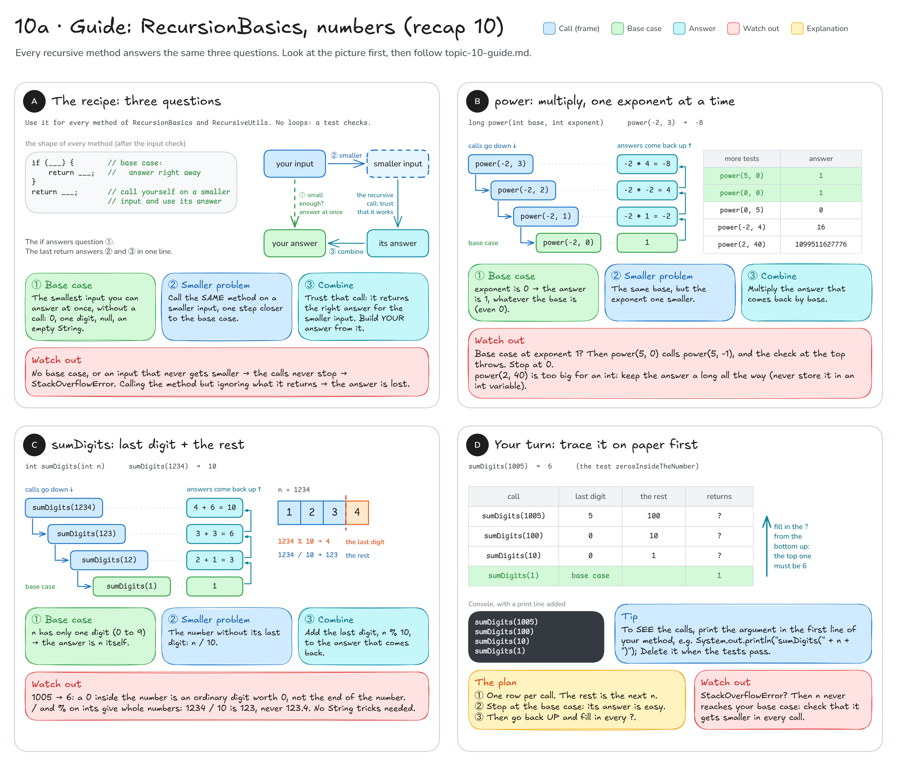
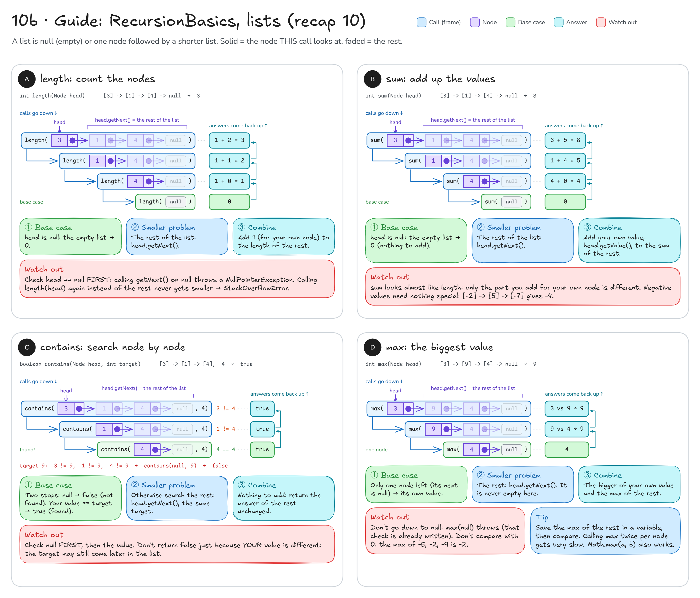
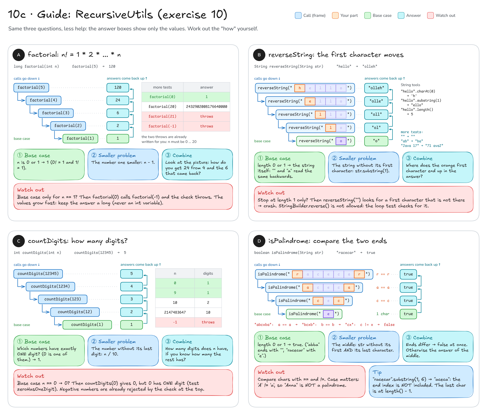

# Topic 10 · Recursion & linked lists: step-by-step guide

This guide walks you through **recap 10 (`RecursionBasics`)** and **exercise 10 (`RecursiveUtils`)**.
It gives you pictures, steps and hints, **not finished code**: you still write every method yourself.

**How to use it:** do one method at a time. Look at its picture, answer its three questions, write the code,
then run that method's tests. Only when they are green, move on.

## Before you start: four facts

1. A recursive method **calls itself** on a **smaller** input. Every call gets its own frame on the stack, with its
   own copy of the parameters. (See [diagram 10](README.md#10--recursion--linked-structures) for the picture.)
2. Every recursive method needs a **base case**: an input so small that you answer it at once, without calling
   yourself. No base case, or an input that never gets smaller → the calls never stop → `StackOverflowError`.
3. Write every method by answering three questions, in this order:
   **① base case** (when do I stop, and what do I return?), **② smaller problem** (what do I pass to the recursive
   call?), **③ combine** (what do I do with the answer that comes back?). For ③, **trust the call**: assume it
   already returns the right answer for the smaller input.
4. **No loops.** No `for`, `while`, `do` and no streams (in `RecursiveUtils` also no `StringBuilder.reverse()`).
   The test `solvedWithoutLoops` reads your file and fails if it finds one.

Most methods in this topic have this shape (some need one extra `if`):

```java
if (___) {        // ① base case
    return ___;
}
return ___;       // ② call yourself on a smaller input, ③ build on its answer
```

The input checks (`throw new IllegalArgumentException(...)`) are already written at the top of the methods:
write your code **below** them.

---

## Part 1 · Recap 10: `RecursionBasics`

You write: `src/main/java/sk/upjs/paz1a/tutoring/recap/exercise10/RecursionBasics.java`. Tests: `RecursionBasicsTest`.
`Node` is complete: you only call `getValue()` and `getNext()` on it.



### A · `power`: multiply, one exponent at a time

**Goal:** `power(2, 10)` → `1024`, `power(-2, 3)` → `-8`, `power(5, 0)` → `1`.

1. **Base case:** for which exponent do you know the answer without multiplying anything? What is it?
   (The Javadoc tells you, and it holds for every base, even 0.)
2. **Smaller problem:** the recursive call keeps the same `base`. What happens to the exponent?
3. **Combine:** the call gives you base to the power of (exponent - 1). What do you do with it to get one power
   higher? In the picture: how does `-8` come out of the `4` that came back?
4. Return that.

Fill in the blanks:

```java
if (___) {
    return ___;
}
return ___;
```

**Check:** run `RecursionBasicsTest`: `powerOfTwo`, `anythingToThePowerOfZeroIsOne`, `zeroToAPositivePowerIsZero`,
`negativeBase`, `largePowerNeedsALong` and `powerRejectsNegativeExponent` should be green, and `solvedWithoutLoops` too.

**Common mistakes**
- Base case at exponent `1`: then `power(5, 0)` calls `power(5, -1)`, and the input check throws.
- Storing a result in an `int` variable: `power(2, 40)` is 1 099 511 627 776, far too big for an `int`.
  Keep it `long` the whole way.

### B · `sumDigits`: last digit + the rest

**Goal:** `1234` → `10`, `0` → `0`, `7` → `7`, `1005` → `6`.

1. Try the Javadoc hint on paper first: `1234 % 10` is `4` (the last digit), `1234 / 10` is `123` (the rest).
2. **Base case:** a number with only **one** digit (0 to 9). What is the digit sum of a single digit?
   (Stopping at `0` instead also works: the digit sum of 0 is 0.)
3. **Smaller problem:** the number without its last digit.
4. **Combine:** you know the digit sum of the rest. What is missing to get the digit sum of the whole number?
5. Trace `sumDigits(1005)` on paper (card D, "Your turn") before you run the tests.

**Check:** `sumOfSeveralDigits`, `digitSumOfZeroIsZero`, `digitSumOfSingleDigit`, `zerosInsideTheNumber`,
`digitSumOfLargestInt`, `sumDigitsRejectsNegativeNumbers`.

**Common mistakes**
- Treating a `0` digit as "the end": `1005` must give `6`, so the zeros inside are just digits worth 0.
- Mixing up `%` and `/`: `%` gives the last digit, `/` throws it away.

---

Now the lists. The test builds them with `listOf(3, 1, 4)`, which is `[3] -> [1] -> [4] -> null`.
A list is just its first node (`head`). `head.getNext()` is **the rest of the list**, which is a list again, one node
shorter. `null` is the empty list. In the pictures, the solid node is the one the current call looks at; the faded
nodes are the rest, which the next call handles.



### C · `length`: count the nodes

**Goal:** `[3] -> [1] -> [4]` → `3`, `[7]` → `1`, `null` → `0`.

1. **Base case:** the empty list (`head` is `null`). How many nodes does it have?
2. **Smaller problem:** the rest of the list.
3. **Combine:** your list has exactly one node more than the rest. How do you get your length from the rest's length?

**Check:** `lengthOfThreeNodes`, `emptyListHasLengthZero`, `singleNodeHasLengthOne`.

**Common mistakes**
- Calling `head.getNext()` before checking for `null`: the empty list crashes with `NullPointerException`.
- Passing `head` again instead of the rest: the list never gets shorter → `StackOverflowError`.

### D · `sum`: add up the values

**Goal:** `[3] -> [1] -> [4]` → `8`, `[-2] -> [5] -> [-7]` → `-4`, `null` → `0`.

1. **Base case:** the empty list. What do its values add up to?
2. **Smaller problem:** the same as in `length`.
3. **Combine:** in `length` every node added 1. Here every node adds something else. What?

**Check:** `sumOfList`, `sumWithNegativeValues`, `emptyListSumsToZero`.

**Common mistakes**
- Using `head.getValue()` in the base case: there, `head` is `null`, so there is no value to read.

### E · `contains`: search node by node

**Goal:** in `[3] -> [1] -> [4]`, target `3` → `true`, target `4` → `true`, target `9` → `false`; `null` → `false`.

This method can stop in **two** ways, so it needs one `if` more than the shape above.

1. **Stop 1:** the empty list. Can it contain the target?
2. **Stop 2:** your node's value **is** the target. What is the answer?
3. **Smaller problem:** otherwise, search the rest of the list for the same target.
4. **Combine:** nothing to add. The answer for the rest is your answer.

**Check:** `containsFindsFirstAndLastValue`, `containsMissingValue`, `emptyListContainsNothing`.

**Common mistakes**
- Reading `head.getValue()` before the `null` check.
- Returning `false` as soon as your own value is different: then only the first node is ever checked, and
  `contains(list, 4)` fails. A different value only means "keep searching".

### F · `max`: the biggest value

**Goal:** `[3] -> [9] -> [4]` → `9`, `[-5] -> [-2] -> [-9]` → `-2`, `[7]` → `7`. `null` throws (already written).

1. **Base case:** a list with **one** node (the Javadoc says so). How can you tell that `head` is the last node?
   What is the biggest value of a one-node list?
2. **Smaller problem:** the rest of the list. You only get here if there is a next node, so the rest is never empty.
3. **Combine:** you have your own value and the biggest value of the rest. Which one do you return?
   Save the answer of the recursive call in a local variable first, then compare (or use `Math.max(a, b)`).

**Check:** `maxInTheMiddle`, `maxAtTheEnd`, `maxOfNegativeValues`, `maxOfSingleNode`, `maxOfEmptyListIsRejected`.

**Common mistakes**
- Going down until `head` is `null`: `max(null)` throws, so every list throws. That is why the base case is one node.
- Comparing with `0` or starting from `0`: for `[-5] -> [-2] -> [-9]` you would return `0` instead of `-2`.
- Writing the recursive call twice (once to compare, once to return): the tests pass, but every level doubles the
  work, so long lists get extremely slow.

---

## Part 2 · Exercise 10: `RecursiveUtils`

You write: `src/main/java/sk/upjs/paz1a/tutoring/exercise10/RecursiveUtils.java`. Tests: `RecursiveUtilsTest`.
The input checks are already written. Less help this time: the pictures show only the values that come back,
and you work out the rule yourself.



### A · `factorial`: n! = 1 · 2 · … · n

**Goal:** `5` → `120`, `0` → `1`, `1` → `1`, `20` → `2432902008176640000`. Only 0 to 20 are allowed.

1. **Base case:** which factorials do you know without computing anything? (The Javadoc gives one, `0! = 1`.)
2. **Smaller problem:** the number one smaller.
3. **Combine:** compare `5! = 5 · 4 · 3 · 2 · 1` with `4! = 4 · 3 · 2 · 1`. How do you get `5!` from `4!`?
   In the picture: how does `120` come out of the `24` that came back?

**Check:** `factorialOfZeroIsOne`, `factorialOfOneIsOne`, `factorialOfFive`, `factorialOfTwentyStillFitsIntoLong`,
`factorialRejectsNegativeNumbers`, `factorialRejectsNumbersAboveTwenty`.

**Common mistakes**
- Base case only for `n == 1`: `factorial(0)` then calls `factorial(-1)`, and the input check throws.
- An `int` variable in between: 20! needs a `long`.

### B · `reverseString`: the first character moves

**Goal:** `"hello"` → `"olleh"`, `"ab"` → `"ba"`, `"Java 17"` → `"71 avaJ"`, `""` → `""`, `"a"` → `"a"`.

1. **Base case:** which strings are already their own reverse? Think about their **length**: there are two such lengths.
2. **Smaller problem:** the string without its first character. The Javadoc names the method for it.
3. **Combine:** the call gives you the reversed rest, e.g. `"olle"` for `"ello"`. Where does the first character
   (`str.charAt(0)`, the orange cell in the picture) have to go to make `"olleh"`?

**Check:** `reverseOfEmptyStringIsEmpty`, `reverseOfSingleCharacterIsTheSame`, `reverseOfTwoCharacters`,
`reverseOfWord`, `reverseKeepsSpacesAndCase`, `reverseRejectsNull`, `solvedWithoutLoops`.

**Common mistakes**
- A base case only for length 1: `reverseString("")` then asks the empty string for its first character
  (or for `substring(1)`) → `StringIndexOutOfBoundsException`.
- `new StringBuilder(str).reverse()`: that is not recursion, and the loop test looks for `.reverse(`.

### C · `countDigits`: how many digits?

**Goal:** `0` → `1`, `9` → `1`, `10` → `2`, `12345` → `5`, `Integer.MAX_VALUE` → `10`.

1. **Base case:** which numbers have exactly **one** digit? Do not forget `0`. What do you return for them?
2. **Smaller problem:** the number without its last digit (the Javadoc hint).
3. **Combine:** `12345` has 5 digits, `1234` has 4. How do you get the first count from the second?

**Check:** `zeroHasOneDigit`, `nineHasOneDigitAndTenHasTwo`, `countDigitsOfLargerNumber`, `countDigitsOfLargestInt`,
`countDigitsRejectsNegativeNumbers`.

**Common mistakes**
- Base case `n == 0` with answer `0`: then `countDigits(0)` returns `0`, but `0` has one digit.
- Copying the base case from `sumDigits` without thinking: there you returned the digit itself, here you count digits.

### D · `isPalindrome`: compare the two ends

**Goal:** `"racecar"` → `true`, `"abba"` → `true`, `""` → `true`, `"x"` → `true`; `"ab"`, `"abcxba"` and
`"Anna"` → `false`.

1. **Base case:** which strings are always palindromes? Again two lengths: `"racecar"` shrinks to `"e"`,
   `"abba"` shrinks to `""`.
2. Compare the **first** and the **last** character. If they differ, you already know the answer: return it at once.
3. **Smaller problem:** the part **between** them. `substring(begin, end)` includes `begin` but **not** `end`:
   `"racecar".substring(1, 6)` is `"aceca"`. Which `end` works for every string?
4. **Combine:** if the two ends match, the whole string is a palindrome exactly when the middle is one.

**Check:** `emptyStringIsPalindrome`, `singleCharacterIsPalindrome`, `oddLengthPalindrome`, `evenLengthPalindrome`,
`twoDifferentCharactersAreNotPalindrome`, `mismatchInTheMiddleIsFound`, `comparisonIsCaseSensitive`,
`isPalindromeRejectsNull`.

**Common mistakes**
- A base case only for length 1: `"abba"` → `"bb"` → `""`, and `""` has no first character.
- Comparing one-letter **Strings** (from `substring`) with `==`: that compares references. Use `charAt`, which gives
  `char` values you can compare with `==` and `!=`.
- `toLowerCase()`: the comparison must be exact, `"Anna"` is **not** a palindrome.

---

**Still stuck?** Trace the smallest failing test on paper, as in card D of the first picture: one line per call with
its argument, stop at the base case, then go back **up** and write down what each call returns. To see the calls
while the program runs, print the argument in the first line of the method (and delete the print afterwards).
