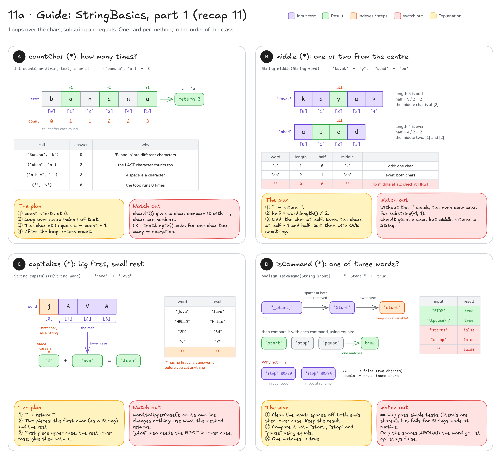
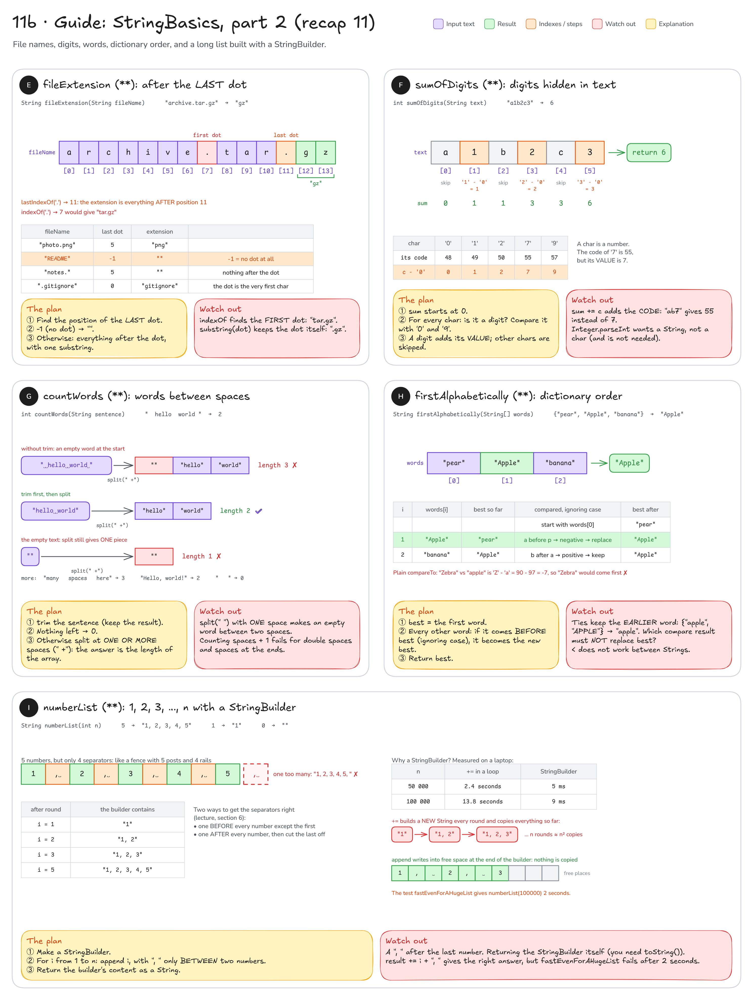
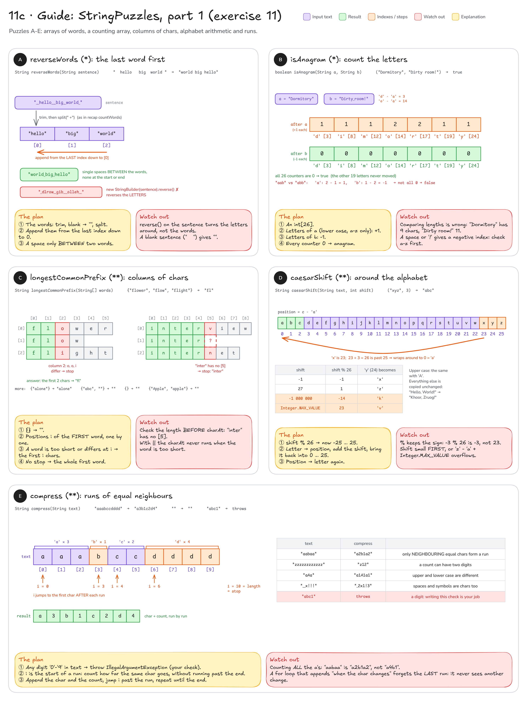
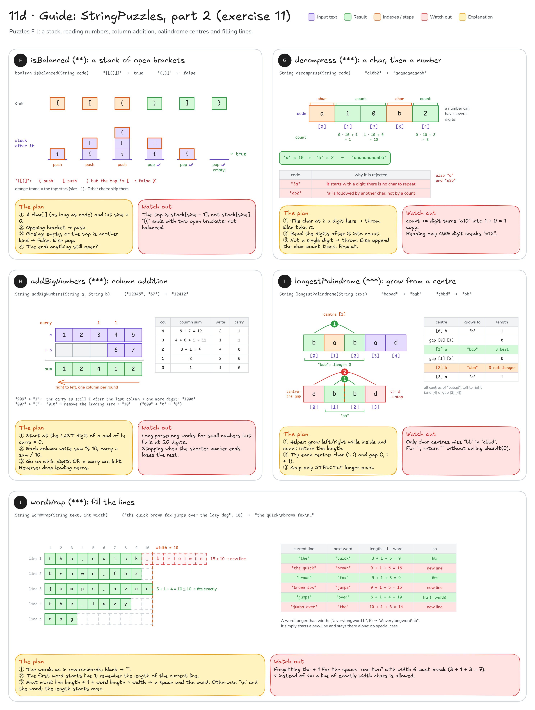

# Topic 11 · Strings: step-by-step guide

This guide walks you through **recap 11 (`StringBasics`)** and **exercise 11 (`StringPuzzles`)**.
It gives you pictures, steps and hints, **not finished code**: you still write every method yourself. The ideas
behind every hint are explained in the [strings lecture](../lectures/topic-11-strings.md); the section numbers below
(like *lecture 4.3*) point into it.

**How to use it:** do one method at a time. Look at its card in the picture, follow the steps, write the code, then
run that method's tests. Only when they are green, move on.

## Before you start: five facts

1. The characters of `text` sit at positions `0` to `text.length() - 1`, like array cells. `length()` is a method,
   so it needs parentheses. (See [diagram 11](README.md#11--strings) for the picture.)
2. **A String never changes.** `toUpperCase()`, `trim()`, `substring(…)`, `replace(…)` return a **new** String.
   A line like `word.trim();` on its own does nothing: keep the result (`word = word.trim();`).
3. Compare **Strings** with `equals`, never with `==`. Compare **chars** with `==`: they are numbers.
4. A char is a number: `'7' - '0'` is `7`, `c - 'a'` is the letter's position 0–25, and `(char) ('a' + 2)` is `'c'`.
5. When you build a String piece by piece in a loop, use a `StringBuilder` and call `toString()` at the end.

The loop you will write most often in this topic:

```java
for (int i = 0; i < text.length(); i++) {
    char c = text.charAt(i);
    // ... do something with c
}
```

---

## Part 1 · Recap 11: `StringBasics`

You write: `src/main/java/sk/upjs/paz1a/tutoring/recap/exercise11/StringBasics.java`. Tests: `StringBasicsTest`.
The `null` checks are already written for you, so you only write the logic. Any method of `String`,
`StringBuilder` and `Character` is allowed.

### Methods A–D (picture 11a)



### A · `countChar` (\*): how many times?

**Goal:** `("banana", 'a')` → `3`, `("Banana", 'b')` → `0`, `("", 'x')` → `0`.

It is `countOccurrences` from recap 05, with a String instead of an array.

1. A counter that starts at `0`.
2. Loop over every index `i` of `text`.
3. When the character at `i` equals `c`, the counter goes up.
4. After the loop, return the counter.

```java
int count = ___;
for (int i = 0; i < ___; i++) {
    if (___ == c) {
        count++;
    }
}
return count;
```

**Check:** `countsRepeatedCharacter`, `missingCharacterCountsZero`, `countIsCaseSensitive`, `countsFirstAndLastCharacter`,
`spacesAreCharactersToo`, `emptyStringCountsZero`, `countCharRejectsNull`.

**Common mistakes**
- `text.length` without `()`: that is the array version and does not compile.
- `i <= text.length()`: the last round asks for `charAt(length())` → `StringIndexOutOfBoundsException`.

### B · `middle` (\*): one or two characters from the centre

**Goal:** `"abc"` → `"b"`, `"kayak"` → `"y"`, `"abcd"` → `"bc"`, `"Java"` → `"av"`, `""` → `""`.

1. Handle the empty word first: return `""` right away.
2. Let `half = word.length() / 2`. Write down `half` for `"kayak"` (length 5) and for `"abcd"` (length 4).
3. Odd length: the middle character is at index `half`. As a String that is `substring(half, ___)`.
4. Even length: the middle two characters are at indexes `half - 1` and `half`. Which `substring(begin, end)` gives
   exactly those two? Remember: `end` is **not** included (lecture 4.3).
5. How do you tell odd from even? (Recap 01.)

**Check:** `middleOfOddLength`, `middleOfEvenLength`, `singleCharacterIsItsOwnMiddle`, `twoCharactersAreBothTheMiddle`,
`middleOfEmptyStringIsEmpty`, `middleRejectsNull`.

**Common mistakes**
- Using `charAt(half)`: that gives a `char`, but the method returns a `String`.
- Forgetting the empty word: for `""` the even-length formula asks for `substring(-1, 1)` → exception.

### C · `capitalize` (\*): first letter big, the rest small

**Goal:** `"java"` → `"Java"`, `"jAVA"` → `"Java"`, `"x"` → `"X"`, `"3D"` → `"3d"`, `""` → `""`.

1. Empty word → return `""` (there is no first character).
2. Cut the word into two pieces: the first character (as a String) and the rest. Which two `substring` calls?
3. Make the first piece upper case and the rest lower case, then glue them together with `+`.

```java
return word.substring(___, ___).toUpperCase() + word.substring(___).___();
```

**Check:** `capitalizesLowerCaseWord`, `fixesMixedCase`, `capitalizesSingleLetter`, `capitalizedWordStaysTheSame`,
`nonLettersStayAsTheyAre`, `capitalizeOfEmptyStringIsEmpty`, `capitalizeRejectsNull`.

**Common mistakes**
- Only upper-casing the first letter: `"jAVA"` must become `"Java"`, so the rest needs `toLowerCase()` too.
- Calling `word.toUpperCase();` on its own line and returning `word`: the result was thrown away (fact 2).

### D · `isCommand` (\*): one of three words?

**Goal:** `"start"`, `"  Stop "`, `"PAUSE"` → `true`; `"starts"`, `"st op"`, `""` → `false`.

1. Clean the input in two steps: remove the spaces at both ends, and make it lower case. Keep the result in a
   variable (fact 2).
2. Compare the clean text with each of the three commands using **`equals`**.
3. Return `true` if any of the three comparisons is true. One `return` with `||` is enough.

**Check:** `recognisesAllThreeCommands`, `comparesContentNotReferences`, `commandIgnoresUpperAndLowerCase`,
`ignoresSpacesAroundTheCommand`, `otherWordsAreNotCommands`, `isCommandRejectsNull`.

**Common mistakes**
- `clean == "stop"`: it may even pass some tests, because literals are shared (lecture 3), but
  `comparesContentNotReferences` passes Strings created while the program runs, and `==` then says `false`.
- Removing **all** spaces (`replace(" ", "")`): then `"st op"` would count as `"stop"`.

### Methods E–I (picture 11b)



### E · `fileExtension` (\*\*): everything after the last dot

**Goal:** `"photo.png"` → `"png"`, `"archive.tar.gz"` → `"gz"`, `".gitignore"` → `"gitignore"`, `"README"` → `""`,
`"notes."` → `""`.

1. Find the position of the **last** dot. Which method searches from the end? (Lecture 4.2.)
2. What does that method return when there is no dot at all? Handle that case.
3. Otherwise, the extension starts one position after the dot and runs to the end: one `substring` call.
4. Does step 3 also work for `"notes."`? Try it on paper: what is `"notes.".substring(6)`?

**Check:** `simpleExtension`, `onlyTheLastDotCounts`, `noDotMeansNoExtension`, `dotAtTheEndGivesEmptyExtension`,
`nameStartingWithDot`, `extensionKeepsItsCase`, `fileExtensionRejectsNull`.

**Common mistakes**
- `indexOf('.')`: finds the **first** dot, so `"archive.tar.gz"` gives `"tar.gz"`.
- `substring(dot)`: includes the dot itself (`".png"`).

### F · `sumOfDigits` (\*\*): digits hidden in text

**Goal:** `"a1b2c3"` → `6`, `"2024"` → `8`, `"ab7"` → `7`, `"no digits"` → `0`.

1. A sum that starts at `0`, and the usual loop over the characters.
2. Is the character a digit? Use the char comparison from lecture 2: `c >= ___ && c <= ___`.
3. If it is, add its **value**, not its code.

```java
if (___) {
    sum += c - ___;
}
```

**Check:** `sumsDigitsBetweenLetters`, `sumsAStringOfDigits`, `usesTheDigitValueNotTheCharacterCode`, `zeroAndNineCount`,
`noDigitsGivesZero`, `sumOfDigitsRejectsNull`.

**Common mistakes**
- `sum += c;`: adds the code. `'7'` is 55, so `"ab7"` gives 55 instead of 7.
- `Integer.parseInt(c)`: does not compile, `parseInt` wants a String. (And it is not needed: `c - '0'` is simpler.)

### G · `countWords` (\*\*): words between spaces

**Goal:** `"the quick brown fox"` → `4`, `"many   spaces    here"` → `3`, `"   hello world   "` → `2`, `""` → `0`,
`"     "` → `0`.

`split` does most of the work, but it has traps. Read the `split` table in lecture 4.6 first.

1. Remove the spaces at both ends first. Why? What does `" hello".split(" +")` give?
2. If nothing is left (the text was empty or only spaces), return `0` right away. Why? What is `"".split(" +")`?
3. Otherwise split at **one or more** spaces. The regex for that is `" +"`. The answer is the length of the array.

**Check:** `countsWordsOfSimpleSentence`, `singleWord`, `severalSpacesBetweenWords`, `spacesAtStartAndEndAreNotWords`,
`emptyStringHasNoWords`, `onlySpacesHasNoWords`, `punctuationBelongsToTheWord`, `countWordsRejectsNull`.

**Common mistakes**
- `split(" ")` (exactly one space): two spaces in a row create an empty word between them.
- Counting spaces + 1: wrong for several spaces in a row and for spaces at the ends.

### H · `firstAlphabetically` (\*\*): the dictionary's first word

**Goal:** `{"pear", "banana", "cherry"}` → `"banana"`, `{"pear", "Apple", "banana"}` → `"Apple"`,
`{"cart", "car"}` → `"car"`, `{"apple", "APPLE"}` → `"apple"`.

It is "find the minimum" from recap 05, with words instead of numbers.

1. Remember the best word so far. Start with the first word of the array.
2. Loop over the other words. When a word comes **before** the best one, it becomes the new best.
3. "Comes before" for Strings is not `<`: use the comparing method from lecture 3 that **ignores case**. Which sign of
   its result means "comes before"?
4. Ties: equal words (ignoring case) must keep the **earlier** one. Strictly smaller or smaller-or-equal?

**Check:** `findsTheAlphabeticallyFirstWord`, `firstWordCanBeAnywhere`, `alphabeticalOrderIgnoresCase`,
`shorterPrefixComesFirst`, `equalWordsKeepTheFirstOne`, `singleWordIsFirst`, `arrayIsNotChanged`,
`firstAlphabeticallyRejectsNullAndEmptyArray`.

**Common mistakes**
- `compareTo` instead of `compareToIgnoreCase`: `"Zebra"` would come before `"apple"`, because `'Z'` (90) < `'a'` (97).
- `<= 0` instead of `< 0`: on a tie the **later** word wins.

### I · `numberList` (\*\*): 1, 2, 3, …, n

**Goal:** `5` → `"1, 2, 3, 4, 5"`, `1` → `"1"`, `0` → `""`, and n = 100 000 in under 2 seconds.

1. Create a `StringBuilder`. (Lecture 5 measures why `+=` takes 14 seconds here.)
2. Loop `i` from `1` to `n`, appending the number `i` each round.
3. The separator `", "` goes **between** numbers: n numbers, n - 1 separators. Read the fence-post part of
   lecture 6 and pick one of its two ways.
4. Return the builder's content as a String.

**Check:** `listUpToFive`, `listOfOneHasNoSeparator`, `noSeparatorAfterTheLastNumber`, `numbersWithSeveralDigits`,
`listOfZeroIsEmpty`, `fastEvenForAHugeList`, `numberListRejectsNegativeN`.

**Common mistakes**
- `result += i + ", ";` in the loop: correct but far too slow, so `fastEvenForAHugeList` fails after 2 seconds.
- A trailing `", "` after the last number.
- Returning the `StringBuilder` instead of a String: you need `toString()`.

---

## Part 2 · Exercise 11: `StringPuzzles`

You write: `src/main/java/sk/upjs/paz1a/tutoring/exercise11/StringPuzzles.java`. Tests: `StringPuzzlesTest`.
Ten puzzles from (\*) to (\*\*\*): go in order. Read the rules at the top of the class: **nothing from `java.util`**
(no lists, maps, `Arrays.sort`), no streams, no `BigInteger`. The test `solvedWithStringsCharsAndArraysOnly`
checks that. Arrays, `String`, `StringBuilder` and `Character` give you everything you need.

**Tip:** write small `private` helper methods (like `isDigit(char c)` or `isLetter…`). The hard puzzles get much
shorter, and you can reuse the helpers.

### Puzzles A–E (picture 11c)



### A · `reverseWords` (\*): the last word first

**Goal:** `"the quick brown fox"` → `"fox brown quick the"`, `"  hello   big  world "` → `"world big hello"`,
`"   "` → `""`.

1. Get the words exactly as in recap `countWords`: trim, handle the blank case, `split(" +")`.
2. Build the result with a `StringBuilder`, going through the array **from the last index down to 0**.
3. Single spaces between the words, none at the end: the fence-post problem again (lecture 6), this time
   counting down.

**Check:** `reversesFourWords`, `reversesTwoWords`, `singleWordStaysTheSame`, `extraSpacesDisappear`,
`wordsKeepTheirCharacters`, `emptyAndBlankSentencesGiveEmptyString`, `reverseWordsRejectsNull`.

**Common mistakes**
- `new StringBuilder(sentence).reverse()`: reverses the **letters** (`"xof nworb …"`), not the order of the words.

### B · `isAnagram` (\*): the same letters, counted

**Goal:** `("listen", "silent")` → `true`, `("Dormitory", "Dirty room!")` → `true`, `("aab", "abb")` → `false`.

Pattern 8.3 in the lecture (a counting array) is the tool.

1. An `int[26]`: one counter per letter.
2. Walk through `a`: for every **letter** (after making it lower case), increase its counter.
   Skip everything that is not `a`–`z`.
3. Walk through `b` the same way, but **decrease** the counters.
4. If the two strings had the same letters the same number of times, what do all 26 counters contain now?
5. Steps 2 and 3 are the same loop with `+1` / `-1`: a good helper method with a parameter for the change.

**Check:** `classicAnagrams`, `anagramIgnoresCaseSpacesAndPunctuation`, `differentLettersAreNotAnagrams`,
`letterCountsMustMatch`, `oneExtraLetterIsNotAnAnagram`, `stringsWithoutLettersAreAnagrams`, `wordIsAnAnagramOfItself`,
`isAnagramRejectsNull`.

**Common mistakes**
- Comparing lengths first: `"Dormitory"` and `"Dirty room!"` have different lengths but are anagrams.
- Only checking that every letter of `a` **occurs** in `b`: `"aab"` and `"abb"` would pass. Count!
- `counts[c - 'a']` for a space or `'!'`: a negative index → crash. Check the range first.

### C · `longestCommonPrefix` (\*\*): how far do all words agree?

**Goal:** `{"flower", "flow", "flight"}` → `"fl"`, `{"interview", "inter", "internet"}` → `"inter"`,
`{"alone"}` → `"alone"`, `{}` → `""`.

1. An empty array → `""`.
2. Use the first word as the reference. Go through its positions `i = 0, 1, 2, …`.
3. For each position, check **every other** word: does it also have the same character at `i`?
4. The first time some word does not (or is too short to have a position `i` at all), the answer is the first `i`
   characters of the reference word. Which `substring`?
5. If the loop finishes without a mismatch, the whole first word is the prefix.

**Check:** `prefixOfThreeWords`, `noCommonPrefix`, `shortestWordLimitsThePrefix`, `identicalWordsAreTheirOwnPrefix`,
`singleWordIsItsOwnPrefix`, `emptyWordMeansEmptyPrefix`, `emptyArrayHasEmptyPrefix`, `prefixIsCaseSensitive`,
`longestCommonPrefixRejectsNulls`.

**Common mistakes**
- `words[w].charAt(i)` before checking `i < words[w].length()`: `"inter"` has no index 5 → exception.
  Put the length check first and join the two checks with `||` so the `charAt` never runs (topic 02: short-circuit).

### D · `caesarShift` (\*\*): rotate the alphabet

**Goal:** `("abc", 1)` → `"bcd"`, `("xyz", 3)` → `"abc"`, `("Hello, World!", 3)` → `"Khoor, Zruog!"`,
`("abc", -1)` → `"zab"`, `("z", Integer.MAX_VALUE)` → `"w"`.

Work out one letter on paper first: `'y'` shifted by `3`.

1. **Make the shift small:** shifting by 26 changes nothing, so shifting by `shift` is the same as shifting by
   `shift % 26`. After this step the shift is between −25 and 25. (This also prevents an `int` overflow for
   `Integer.MAX_VALUE`.)
2. For a lower-case letter `c`: its position in the alphabet is `c - 'a'` (0–25). Add the shift. The new position may
   now be below 0 or above 25: bring it back into 0–25. Remember, `%` keeps the sign: `-3 % 26` is `-3`, not 23.
   What can you add **before** taking `% 26` so the number is never negative?
3. Turn the new position back into a letter: `(char) ('a' + ___)`.
4. Upper-case letters: the same with `'A'`. Every other character is appended unchanged.
5. Steps 2–3 are the same for `'a'` and `'A'`: a helper with the first letter of the alphabet as a parameter.

**Check:** `shiftByOne`, `wrapsAroundFromZToA`, `keepsCaseAndOtherCharacters`, `negativeShiftMovesBackwards`,
`shiftsLargerThanTheAlphabet`, `hugeNegativeShift`, `extremeShiftsDoNotOverflow`, `zeroShiftChangesNothing`,
`shiftingBackUndoesTheShift`, `caesarOfEmptyTextIsEmpty`, `caesarShiftRejectsNull`.

**Common mistakes**
- `(char) (c + shift)` without wrapping: `'z' + 1` is `'{'`.
- Wrapping with `% 26` only: a negative position stays negative, `"abc"` shifted by `-1` gives garbage.
- Adding `shift` before making it small: `'z' - 'a' + Integer.MAX_VALUE` overflows.

### E · `compress` (\*\*): count the runs

**Goal:** `"aaabccdddd"` → `"a3b1c2d4"`, `"aabaa"` → `"a2b1a2"`, `"z"` × 12 → `"z12"`, `""` → `""`.

1. **Input check (yours to write):** if the text contains any digit `'0'`–`'9'`, throw an
   `IllegalArgumentException`. (One loop before the real work.)
2. Walk through the text with an index `i` that **you** move (a `while` loop): at each step, `i` is the start of a
   new run.
3. Count how far the run goes: how many characters from `i` on are equal to `text.charAt(i)`? Careful not to walk
   past the end.
4. Append the character and the count, then jump `i` to the first character **after** the run.

```
"aaabcc":  i=0 run of 'a' has length 3 → "a3", i = 3
           i=3 run of 'b' has length 1 → "b1", i = 4
           i=4 run of 'c' has length 2 → "c2", i = 6 = length → stop
```

**Check:** `compressesRuns`, `everyCharacterAlone`, `longRunHasACountWithSeveralDigits`, `sameCharacterLaterStartsANewRun`,
`compressIsCaseSensitive`, `spacesAndSymbolsAreCharactersToo`, `compressOfEmptyTextIsEmpty`, `compressRejectsDigits`,
`compressRejectsNull`.

**Common mistakes**
- Counting **all** occurrences of a character (`"aabaa"` → `"a4b1"`): only **neighbouring** equal characters form a run.
- Forgetting the last run: with a `for` loop that appends "when the character changes", the final run never sees a
  change. (The `while` loop from step 2 avoids that.)

### Puzzles F–J (picture 11d)



### F · `isBalanced` (\*\*): matching brackets

**Goal:** `"([]{})"` → `true`, `"if (a[0] > 1) { x(); }"` → `true`, `"([)]"` → `false`, `"(("` → `false`,
`")("` → `false`.

Counting brackets is **not** enough: `"([)]"` has one of each, but they cross. You need a stack (lecture 8.8).

1. A `char[]` as long as the text and an `int size = 0`.
2. An opening bracket: push it.
3. A closing bracket: two things can go wrong. Which one do you check first?
   - nothing is open (the stack is empty) → not balanced,
   - the most recently opened bracket (the top of the stack) is of a different kind → not balanced.
   If it matches, pop it.
4. Any other character: ignore it.
5. After the loop, one more question decides the answer: is anything still open?
6. A helper `isPair(char open, char close)` keeps step 3 readable.

```
"{[()]}"   {  → [{]      [  → [{ []     (  → [{ [ (]
           )  → top ( matches → [{ []    ]  → top [ matches → [{]    }  → top { matches → []   empty → true
```

**Check:** `simplePairs`, `nestedAndSideBySide`, `crossedPairsAreNotBalanced`, `wrongKindOfBracket`, `bracketLeftOpen`,
`closingBeforeOpening`, `otherCharactersAreIgnored`, `emptyCodeIsBalanced`, `deepNesting`, `isBalancedRejectsNull`.

**Common mistakes**
- Reading `stack[size]` as the top: the top element is at `size - 1`.
- Returning `true` after the loop without checking `size`: `"(("` would count as balanced.

### G · `decompress` (\*\*\*): undo the compression

**Goal:** `"a3b1c2"` → `"aaabcc"`, `"z12"` → twelve `z`, `"a10b2"` → `"aaaaaaaaaabb"`, `""` → `""`;
`"3a"`, `"a"`, `"ab2"` → `IllegalArgumentException`.

The input is a repeating pattern: **one character, then one or more digits**. Read it with an index you move
yourself (lecture 8.6), one pattern at a time:

1. At the start of each pattern, the character at `i` must **not** be a digit. If it is, throw. Remember the
   character and move `i` on.
2. Now read the count: while the character at `i` is a digit, add it to the number with
   `count = count * ___ + ___` and move `i` on. (Lecture 8.6 traces `"4096"` this way.)
3. If step 2 did not read a single digit, the character had no count: throw. How can you tell? Remember where the
   count should have started.
4. Append the character `count` times.
5. Repeat until `i` reaches the end.

**Check:** `expandsRuns`, `countsCanHaveSeveralDigits`, `spacesAndSymbolsCanBeRepeated`, `decompressOfEmptyCodeIsEmpty`,
`characterWithoutCountIsRejected`, `codeStartingWithDigitIsRejected`, `decompressRejectsNull`.

**Common mistakes**
- Reading only **one** digit after each character: `"z12"` becomes `"z"` once and then fails at `'2'`.
- `count += c - '0'` instead of `count * 10 + …`: `"z12"` gives a count of 3 (1 + 2).

### H · `addBigNumbers` (\*\*\*): column addition

**Goal:** `("123", "456")` → `"579"`, `("999", "1")` → `"1000"`, `("007", "3")` → `"10"`,
30-digit numbers too.

Add the way you learned at school: right to left, one column at a time, carrying the ten.

```
    1 2 3 4 5
  +       6 7
  -----------          column: 5 + 7 = 12 → write 2, carry 1
    1 2 4 1 2                  4 + 6 + 1 = 11 → write 1, carry 1 ...
```

1. Two indexes start at the **last** digit of each number, and a `carry` starts at 0.
2. Each round: column sum = carry + the digit of `a` at its index (if there is one left) + the digit of `b` (if there
   is one left). A digit's value is `c - '0'`.
3. The digit to write is `sum % 10`, the new carry is `sum / 10`. Move both indexes one to the left.
4. Keep going while **either** number still has digits **or** there is a carry left. (Why the carry? Think of
   `999 + 1`.)
5. You produced the digits from right to left: collect them in a `StringBuilder` and reverse it at the end
   (`reverse()` is allowed here).
6. Leading zeros: `"007" + "3"` produces `"010"`. Remove zeros from the front, but never the last remaining digit.
   (Tip: before reversing, the "front" zeros are at the **end** of the builder, where they are cheap to cut off.)

**Check:** `addsSmallNumbers`, `carryTravelsAllTheWay`, `numbersOfDifferentLengths`, `addingZero`, `numbersTooBigForLong`,
`leadingZerosAreRemovedFromTheResult`, `addBigNumbersRejectsInvalidInput`.

**Common mistakes**
- `Long.parseLong(a) + Long.parseLong(b)`: works for small numbers, crashes for 20 digits and more.
- Stopping when the shorter number runs out.
- Forgetting the final carry: `999 + 1` gives `"000"` instead of `"1000"`.

### I · `longestPalindrome` (\*\*\*): grow from every centre

**Goal:** `"babad"` → `"bab"`, `"cbbd"` → `"bb"`, `"forgeeksskeegfor"` → `"geeksskeeg"`, `"abc"` → `"a"`, `""` → `""`.

Every palindrome has a **centre**: one character (`"aba"`, centre `b`) or the gap between two equal characters
(`"abba"`, centre between the two `b`s). A text of length n has n character centres and n - 1 gap centres.

1. A helper that gets a `left` and a `right` index and **grows** outwards: while both are inside the text and the
   characters at `left` and `right` are equal, move `left` one to the left and `right` one to the right. Then return
   the length of the palindrome it found. (When the loop stops, `left` and `right` are one step **outside** the
   palindrome: what is its length then?)
2. For a character centre at `i`, start the helper with `left = right = i`. For the gap after `i`, start with
   `left = i`, `right = i + 1`.
3. Remember the best length and where the best palindrome **starts**. Work out the start from the centre and the
   length on paper for `"babad"` (centre 1, length 3) and `"cbbd"` (gap after 1, length 2).
4. Go through the centres from left to right and only replace the best one with a **strictly longer** palindrome:
   then the leftmost one wins a tie.
5. Return the best palindrome with one `substring`.

**Check:** `oddLengthPalindrome`, `evenLengthPalindrome`, `wholeTextIsAPalindrome`, `palindromeHiddenInside`,
`leftmostOfEquallyLongPalindromes`, `withoutRepeatsTheFirstCharacterWins`, `palindromeIsCaseSensitive`, `shortTexts`,
`longestPalindromeRejectsNull`.

**Common mistakes**
- Only trying character centres: `"cbbd"` → `"c"` instead of `"bb"`.
- `>=` when comparing with the best: a later palindrome of the same length replaces the leftmost one.
- An empty text: make sure your code returns `""` and does not call `charAt(0)`.

### J · `wordWrap` (\*\*\*): fill the lines

**Goal:** `("the quick brown fox jumps over the lazy dog", 10)` →
`"the quick\nbrown fox\njumps over\nthe lazy\ndog"`; `("a verylongword b", 5)` → `"a\nverylongword\nb"`.

1. Get the words as in `reverseWords`. A blank text → `""`.
2. Keep a `StringBuilder` for the result and an `int` with the length of the **current** line.
3. The first word always starts the first line.
4. For every next word: would it still fit on the current line? It needs **one space plus** its own length.
   - It fits (`≤ width`): append a space and the word, and update the line length.
   - It does not fit: append `'\n'` and the word, and the line length starts over.
5. A word longer than `width` needs no special case: it simply starts a new line and stays there alone. Check it with
   `("a verylongword b", 5)` on paper.

```
width 10:  "the" (3) → "the quick" (3 + 1 + 5 = 9 ✔) → + " brown" would be 15 ✘ → new line "brown" ...
```

**Check:** `wrapsAtTheWidth`, `exactFitStaysOnOneLine`, `oneCharacterTooLongStartsANewLine`, `tooLongWordGetsALineOfItsOwn`,
`everythingFitsOnOneLine`, `extraSpacesDisappearWhenWrapping`, `widthOnePutsEveryWordOnItsOwnLine`,
`blankTextGivesEmptyString`, `everyLineFollowsTheRules`, `wordWrapRejectsNullAndBadWidth`.

**Common mistakes**
- Forgetting the space when checking the fit: `"one two"` with width 6 must break (3 + 1 + 3 = 7 > 6).
- `<` instead of `<=`: a line of exactly `width` characters is allowed.
- Appending `" " + word` also for the first word of a line: the line then starts with a space.

---

**Still stuck?** Trace the smallest failing test on paper: write the input with the indexes under it, then go through
your loop one round at a time, writing down every variable after each round. For a `StringBuilder`, write down its
content too. The moment your table differs from what you expected is where the bug is. To watch it while the program
runs, print the variables inside the loop (and delete the print afterwards).
